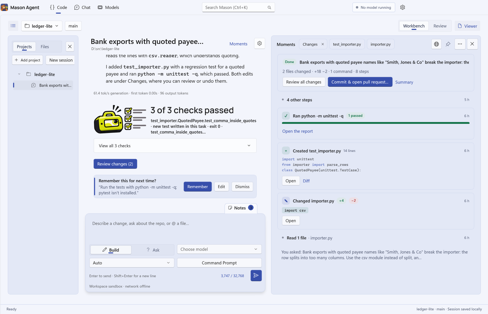

<div align="center">


# Mason Agent

**Make the next move clear.** A coding agent that runs on your own local models, as a native app for Windows, macOS and Linux and as `mason` in your terminal.

[Website](https://masonagent.site) · [All releases](https://github.com/afj176/mason-agent/releases)

**Download:** [Windows installer](https://github.com/afj176/mason-agent/releases/latest/download/MasonAgent-Setup-x64.exe) · [macOS installer](https://github.com/afj176/mason-agent/releases/download/preview/MasonAgent-macos.pkg) · [Linux .deb](https://github.com/afj176/mason-agent/releases/download/preview/mason-agent-linux-amd64.deb) · [more options](#install)

</div>

<picture><source media="(prefers-color-scheme: dark)" srcset="docs/images/code-dark.png"></picture>

Add a project folder, ask for a change, and review every edit before you keep it. Your code and your conversations stay on your computer: models are reached only on localhost, and there is no account and no telemetry.

## Quick start

1. [Install](#install) the app for your system.
2. Open **Models** and run **Quick setup**. It installs llama.cpp and downloads a coding model that fits your computer, after you confirm.
3. Add a project folder and describe a change.

Or in a terminal, with no options:

```sh
cd my-project
mason
```

A GPU is recommended. Mason shows whether each model fits in your memory before you start it.

## What it does

- **Reviewed edits.** Every edit shows as a diff. Sessions start read-only; you choose whether Mason asks before each edit and command or works on its own.
- **A sandbox for Auto.** In Auto, commands run in your system's sandbox, limited to the project and with no network unless you allow a destination.
- **Undo a whole request.** Undo puts back everything a request changed, including files its commands created or deleted. Files you edited since are left alone.
- **Your own models.** GGUF models run through llama.cpp, with no separate server to start. Transformers weights and any OpenAI-compatible server on localhost work too.
- **A model library.** See which models on your computer suit the agent and fit your memory, and search and download from Hugging Face.
- **Checks before it says done.** Language servers check each edit, and your project's tests run before a request finishes, so the model fixes what they catch.
- **Your agents, commands and MCP servers.** Markdown agents and slash commands in `.mason/`, and the ones you keep in `.claude/` and `.opencode/`. MCP tools are called only when you switch them on.
- **Chat.** Talk a problem through with a model, apart from your coding sessions, with documents and pictures attached.
- **Schedules and notifications.** Run a request hourly, daily or weekly, unattended. Your system tells you when a session finishes or needs you.
- **Themes.** Five theme families, each in light and dark, shared by the app and `mason`.

<picture><source media="(prefers-color-scheme: dark)" srcset="docs/images/themes-dark.png"></picture>

There is much more: comments on diff lines, experiments in worktrees, pull request drafts, background tasks, pages checked in a real browser. See [everything Mason Agent does](docs/features.md).

## Install

### Windows

Download from the [latest release](https://github.com/afj176/mason-agent/releases/latest):

- **Installer** (`MasonAgent-Setup-x64.exe`): installs for your Windows account with no administrator rights, and can add `mason` to your PATH. Requires Windows 11.
- **Portable ZIP** (`MasonAgent-win-x64.zip`): extract the folder anywhere and run `MasonAgent.exe`. Runs on Windows 11 and on Windows 10 version 2004 or later. Add its `bin` folder to your PATH for `mason`.

Both are x64 and need nothing else installed. Releases are not code-signed yet, so Windows SmartScreen may warn on first run: choose **More info → Run anyway**.

Settings and sessions are kept in `%LOCALAPPDATA%\MasonAgent`. To keep them beside a portable copy, put an empty file named `portable.flag` next to `MasonAgent.exe`.

### macOS

For macOS 14 or later on Apple silicon and Intel. Download from the [release page](https://github.com/afj176/mason-agent/releases/tag/preview):

- **Installer** ([`MasonAgent-macos.pkg`](https://github.com/afj176/mason-agent/releases/download/preview/MasonAgent-macos.pkg)): puts Mason Agent in Applications and `mason` in `/usr/local/bin`.
- **App only** ([`MasonAgent-macos.zip`](https://github.com/afj176/mason-agent/releases/download/preview/MasonAgent-macos.zip)): drag the app into Applications, then choose **Agent → Install Command Line Tool…** if you want `mason`.

The app is not notarized by Apple, so macOS blocks it the first time. Open **System Settings → Privacy & Security** and choose **Open Anyway**.

Settings and sessions are kept in `~/Library/Application Support/MasonAgent`.

### Linux

For x64. Download from the [release page](https://github.com/afj176/mason-agent/releases/tag/preview):

- **Debian and Ubuntu** ([`mason-agent-linux-amd64.deb`](https://github.com/afj176/mason-agent/releases/download/preview/mason-agent-linux-amd64.deb)), for Ubuntu 24.04 or newer:

  ```sh
  sudo apt install ./mason-agent-linux-amd64.deb
  ```

- **Other distributions** ([`mason-agent-linux-amd64.tar.gz`](https://github.com/afj176/mason-agent/releases/download/preview/mason-agent-linux-amd64.tar.gz)): installs for your user under `~/.local`. It needs GTK 4, gtkmm 4.10, libadwaita 1.4 and libcurl, and lists any that are missing.

  ```sh
  tar -xzf mason-agent-linux-amd64.tar.gz
  cd mason-agent-*-linux-amd64 && ./install.sh
  ```

Install bubblewrap to use Auto; without it, Auto refuses to run commands instead of running them unprotected. Mason Agent is tested on Ubuntu 24.04 and has not been tried on other distributions yet.

Settings and sessions are kept in `~/.local/share/MasonAgent`.

## The mason command line

`mason` is the same agent in your terminal. Run it in a project folder: it uses a model that is already running, restarts the one you used last, or helps you pick or download one.

Type a request and each step prints as it finishes. Approvals take one key: `y` once, `a` always for this project, `n` decline. Esc stops a run.

| In a session | |
| --- | --- |
| `/diff` · `/undo` · `/redo` | See what changed; put back or reapply everything the last request did |
| `/permission read\|review\|edits\|auto` | What Mason may do without asking |
| `/ask` · `/build` | Answer questions only, or make changes |
| `/new` · `/resume` | Start a session, or continue an earlier one |
| `/models` | The models on this computer; `start`, `search`, `download` and `setup` manage them |
| `/theme` | Choose the theme the app and `mason` share |
| `/help` | Everything else |

[More on the command line](docs/cli.md), including options and use in scripts.

## More

- [Everything Mason Agent does](docs/features.md)
- [Install details](docs/install.md): getting a model, where your data is kept, requirements

## Build from source

Each platform is its own native project: WinUI 3 and C# in [`windows/`](windows), SwiftUI and Swift in [`macos/`](macos), GTK 4 and C++ in [`linux/`](linux). [Building from source](docs/contributing.md) has the steps for each.

## Privacy

Everything stays on your computer: projects, sessions, chats and settings live in your local profile, and models are reached only on localhost. Mason Agent connects to the internet only when you ask it to: searching or downloading models from Hugging Face, setting up the optional quantized runtime, or allowing a specific destination for a sandboxed command. There is no telemetry.

## License

[MIT](LICENSE). Manrope is used under the SIL Open Font License 1.1; see [THIRD-PARTY-NOTICES.md](THIRD-PARTY-NOTICES.md).
