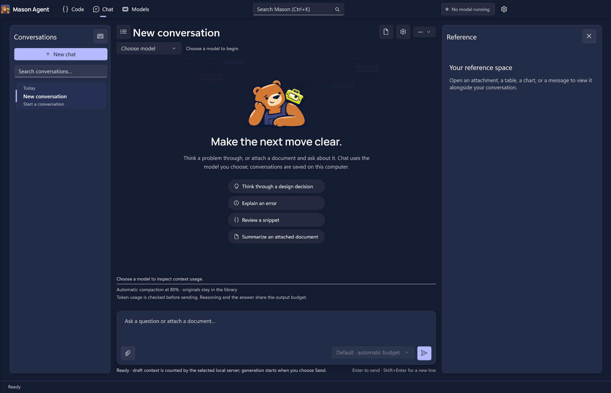
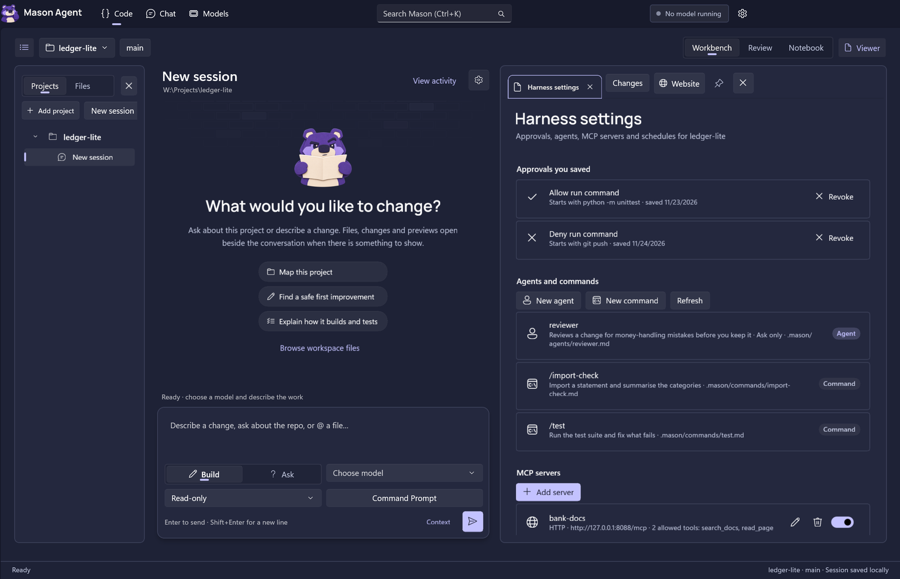
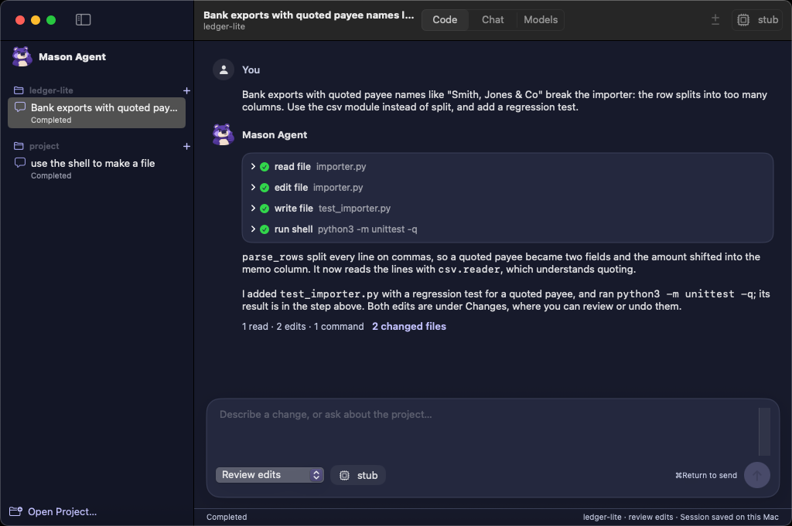
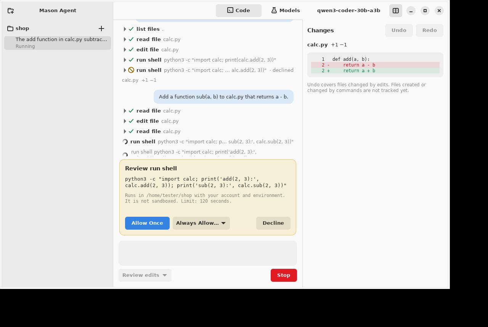

<div align="center">


# Mason Agent

**Make the next move clear.** A coding workspace and command line that run on your own local models. Native apps for Windows, macOS and Linux.

[Website](https://masonagent.site) · [All releases](https://github.com/afj176/mason-agent/releases)

**Download:** [Windows installer](https://github.com/afj176/mason-agent/releases/latest/download/MasonAgent-Setup-x64.exe) · [macOS installer (preview)](https://github.com/afj176/mason-agent/releases/download/preview/MasonAgent-macos.pkg) · [Linux .deb (preview)](https://github.com/afj176/mason-agent/releases/download/preview/mason-agent-linux-amd64.deb) · [more options](#install)

</div>


## Platforms

Each platform has its own native app and its own engine, written for that system. They share the product, not the code.

| | App | Engine and `mason` | Sandbox for Auto | Status |
| --- | --- | --- | --- | --- |
| **Windows** | WinUI 3 | C# | Windows sandbox limited to the project | Released |
| **macOS** | SwiftUI | Swift | macOS sandbox (`sandbox-exec`) | Preview download |
| **Linux** | GTK 4 and libadwaita | C++ | bubblewrap | Preview download |

The macOS and Linux previews cover most of what the Windows app does: sessions, reading and searching a project, reviewed edits with diffs, undo of everything a request changed (including what its commands created, changed or deleted), commands with approvals and always-allow rules, the four permission modes, conversation compaction, custom agents and slash commands, MCP servers, chat, queue and steer, schedules and notifications, background jobs, project workflows and skills, verification receipts, checks of a project page in a real browser (Chrome, Chromium, Edge or Brave, headless), comments pinned to lines of a diff, a reviewing pass by the model, milestones, acceptance scenarios from `mason.acceptance.json`, code search by meaning with an embeddings server, reading and operating a window you attach, forking, exporting and importing sessions, finding definitions and references, and finding, downloading and running models: GGUF with llama.cpp, and Transformers weights through Python. Still Windows-only: experiments in separate worktrees, drafting a branch and pull request with CI feedback, background tasks that outlive the app, separate reviewer and vision models, pinned project tests as evidence, project policy and bundles, the Website tab with its element picker, the in-app file viewer, asking for network access per destination in Auto, and some scripted CLI operations (`review`, `browse`, `serve`). Two more differences: for C#, Windows binds names with the compiler built into the app; macOS and Linux ask the C# language server you have installed (csharp-ls or OmniSharp), and give labelled text matches without one. And the previews are new: each release lists what was run on a real machine and what was not.

Each platform lives in its own folder and builds on its own, with nothing shared but the brand kit, the docs and this README:

| Folder | What it holds |
| --- | --- |
| [`windows/`](windows) | The WinUI 3 app, the C# engine and `mason`, their checks, build scripts and installer |
| [`macos/`](macos) | The Swift package: engine, `mason`, the SwiftUI app, tests and packaging |
| [`linux/`](linux) | The Meson project: C++ engine, `mason`, the GTK 4 app, tests and packaging |
| [`site/`](site), [`brand/`](brand), [`docs/`](docs) | The website, the brand kit and shared documentation |

## Install

### Windows

Download from the [latest release](https://github.com/afj176/mason-agent/releases/latest):

- **Installer** (`MasonAgent-Setup-x64.exe`, about 106 MB): installs for your Windows account into `%LOCALAPPDATA%\Programs\MasonAgent`; no administrator rights needed. From version 2.2.1 it can also add the `mason` command to your PATH. Requires Windows 11.
- **Portable ZIP** (`MasonAgent-win-x64.zip`, about 125 MB): extract the whole folder anywhere and run `MasonAgent.exe`. Runs on Windows 11 and on Windows 10 version 2004 or later.

Both are x64 and self-contained (.NET and the Windows App SDK are included). Releases are not code-signed yet, so Windows SmartScreen may warn on first run: choose **More info → Run anyway**. SHA-256 files are attached to each release.

**You also need a model.** Model weights and runtimes are not bundled. The quickest start is **Models → Quick setup**, which installs llama.cpp for your GPU and downloads a coding model that fits after you confirm. Or point Mason Agent at:

- GGUF weights. Mason Agent runs them inside the app with a llama.cpp build that includes `llama-server-impl.dll` (current releases do). Turn off **Run GGUF models inside Mason** under Models → Runtimes to give each model its own `llama-server` process instead, or
- Transformers (safetensors) weights plus a Python installation with the needed packages (an optional isolated runtime for GPTQ/AWQ models can be set up from the app; that setup downloads Python packages), or
- an OpenAI-compatible server already running on `localhost` / `127.0.0.1`.

Git for Windows is optional and adds Git Bash as a shell for commands. Using PowerShell in Auto mode needs a one-time setup that asks for administrator approval.

**Where settings live.** Settings, projects, sessions and chats are stored in `%LOCALAPPDATA%\MasonAgent`. To keep everything beside the app instead, put an empty file named `portable.flag` next to `MasonAgent.exe`; data then goes to a `data` folder in the same directory. The `MASON_DATA_HOME` environment variable overrides both. Your project folders are never moved; only the edits you allow are written to them.

### macOS

Preview, for macOS 14 or later on Apple silicon and Intel. Download from the [preview release](https://github.com/afj176/mason-agent/releases/tag/preview):

- **Installer** ([`MasonAgent-macos.pkg`](https://github.com/afj176/mason-agent/releases/download/preview/MasonAgent-macos.pkg)): puts Mason Agent in Applications and links `mason` into `/usr/local/bin`, so it works in every terminal.
- **App only** ([`MasonAgent-macos.zip`](https://github.com/afj176/mason-agent/releases/download/preview/MasonAgent-macos.zip)): drag the app into Applications, then choose **Agent → Install Command Line Tool…** in the menu bar if you want `mason`.

The preview is signed ad hoc and not notarized by Apple, so macOS blocks it the first time. Open **System Settings → Privacy & Security** and choose **Open Anyway**; on macOS 14 you can also right-click the file and choose **Open**.

Every change is built and checked on a macOS 15 runner: the tests (including real commands under the sandbox), the `.pkg` install, a sandboxed `mason` request in Auto, and a request typed into the app and approved there. That check uses a stand-in model, and the preview has had little use on people's own Macs yet.

Settings, sessions and downloaded models live in `~/Library/Application Support/MasonAgent`. `MASON_DATA_HOME` overrides the location.

### Linux

Preview, for x64. Download from the [preview release](https://github.com/afj176/mason-agent/releases/tag/preview):

- **Debian and Ubuntu** ([`mason-agent-linux-amd64.deb`](https://github.com/afj176/mason-agent/releases/download/preview/mason-agent-linux-amd64.deb)): installs `mason` and `mason-agent` in `/usr/bin` with a menu entry. Built on Ubuntu 24.04; needs that or a newer Debian or Ubuntu.

  ```sh
  sudo apt install ./mason-agent-linux-amd64.deb
  ```

- **Other distributions** ([`mason-agent-linux-amd64.tar.gz`](https://github.com/afj176/mason-agent/releases/download/preview/mason-agent-linux-amd64.tar.gz)): installs for your user under `~/.local` without administrator rights, tells you if `~/.local/bin` is not on your PATH yet, and `install.sh --uninstall` removes it. Needs GTK 4, gtkmm 4.10 or later, libadwaita 1.4 or later and libcurl from your distribution; the installer lists any that are missing.

  ```sh
  tar -xzf mason-agent-linux-amd64.tar.gz
  cd mason-agent-*-linux-amd64 && ./install.sh
  ```

Install bubblewrap to use Auto. Without it Mason still works, and Auto refuses to run commands instead of running them unprotected. The preview is built and checked on Ubuntu 24.04 for every change and has not been tried on other distributions. There is no Flatpak, RPM or arm64 build yet.

Settings, sessions and downloaded models live in `~/.local/share/MasonAgent` (or `$XDG_DATA_HOME/MasonAgent`). `MASON_DATA_HOME` overrides the location.

## The mason command line

This section describes `mason` on Windows. On macOS (Swift) and Linux (C++) the same command has the session and model commands below; it has `/compact`, `/agent`, `/commands`, `/mcp` and `/queue` too, and it has the script operations `exec`, `map`, `symbol` and `git-status` (not `review`, `browse`, `serve`, `worktree` or the task commands). While Mason works there, type a message and press Enter to queue it, or start it with `!` to steer.

`mason` is the same agent in your terminal. The macOS installer and both Linux packages put it on your PATH. On Windows it arrives with version 2.2.1: the installer can add it to your PATH, and with the portable ZIP you add its `bin` folder yourself.

```powershell
cd D:\src\shop
mason
```

No options are needed. On start, `mason` uses a model that is already running, otherwise restarts the one you used last, otherwise lists the coding models on your computer to pick from, and with none installed offers to download one that fits your GPU.

Type a request and each tool call prints as it finishes. Approvals take one key: `y` once, `a` always for this project, `n` decline. Esc stops a run.

| In a session | |
| --- | --- |
| `/diff` · `/undo` · `/redo` | See what changed; put back or reapply everything the last request did |
| `/permission read\|review\|edits\|auto` | What Mason may do without asking. `auto` runs commands in the Windows sandbox |
| `/ask` · `/build` | Answer questions only, or make changes |
| `/new` · `/resume` · `/compact` · `/status` | Start, continue, shrink or inspect a session |
| `/model` | Switch between running models and saved connections |
| `/models` | The models on this computer and what each can do for the agent |
| `/models start` · `/models stop` | Run a GGUF coding model with llama.cpp for this session |
| `/models search TEXT` · `/models download REPO` | Find a model on Hugging Face, see its builds and which fit, download one |
| `/models setup` · `/models runtime` | Suggest and download a model that fits; install llama.cpp for your GPU |
| `/rules` · `/agent` · `/commands` | Saved approvals, and your agents and commands from `.mason/` |
| `/comment` · `/review` · `/milestone` · `/accept` · `/window` · `/embeddings` · `/fork` · `/export` · `/import` | On macOS and Linux: pin a note to a line, have the model review the changes, keep a plan, run acceptance scenarios, attach a window, choose an embeddings server, fork a session from an earlier request, save or add a session as a file |

`/help` has the full list. Options when starting: `--workspace PATH`, `--resume [SESSION]`, a permission (`--read-only`, `--review`, `--edits`, `--auto`), and `--endpoint URL --model ID` for any OpenAI-compatible server on localhost.

Good to know: a model started from the terminal stops when you leave `mason`. Downloads share one queue with the desktop app, so close the app or download there while it is open. Approval rules, model files, agents and commands are shared with the desktop app; terminal sessions are kept separately and do not appear in its session list.

**For scripts.** The same executable runs single operations that print JSON Lines and exit 0 on success. `exec` is read-only unless you pass `--auto`.

```powershell
mason exec --workspace D:\src\shop --endpoint http://127.0.0.1:8080 --model YOUR_MODEL --auto --prompt-file brief.txt
mason review --workspace D:\src\shop --endpoint http://127.0.0.1:8080 --model YOUR_MODEL --prompt-file brief.txt
mason worktree --workspace D:\src\shop --destination D:\src\shop-pricing --branch mason/pricing
mason symbol --workspace D:\src\shop --path src/cart.ts --line 12 --column 8 --mode references
```

Each run gets its own journal, so builds can run in parallel against separate worktrees (the project menu also offers **New isolated worktree**). `mason --help` lists browser tasks, background tasks and session resume. For a real development server, `serve --workflow preview --port 8123` runs the named workflow under your Windows account, verifies the loopback listener belongs to its process tree, proxies the disposable browser to it, then stops the tree.

## Windows app

A WinUI 3 app with the engine written in C#, in [`windows/`](windows).

### What it does

- **Projects that keep their history.** Add a folder to keep its sessions, files and changes together. Right-click a project in the sidebar or open its project menu and choose **Remove project from Mason**. Its files stay on disk. Adding the same folder again restores its sessions and project notes. Switch between Code, Chat and Models in the title bar. Ctrl+K searches sessions, projects, workspace files and commands. Each session remembers its workspace view. Workbench pairs the conversation with its artifacts, Review opens line comments beside the recorded checks, and Notebook gives the conversation a wider reading layout and follows your Mason appearance setting.
- **Runs on your own models.** GGUF models run inside Mason Agent through llama.cpp, so there is no separate server process to start or keep alive. Transformers models run with Python, and you can connect to an OpenAI-compatible server already running on localhost. **Quick setup** under Models checks your GPU, installs the matching llama.cpp build, suggests a coding model that fits in its memory and starts it once you confirm the download.
- **You set the permissions.** Sessions start read-only. Switch to *Review edits* (approve each edit and command), *Workspace edits*, or *Auto*, which runs commands in a Windows sandbox limited to the project folder with network access off unless you allow a destination. Commands run in Git Bash, PowerShell or Command Prompt. On an approval, **Always allow…** saves an editable rule for that command prefix, folder or MCP tool in this project. A deny rule always wins, and you can revoke rules in Harness settings (project menu → **Project policy & extensions**).
- **Every change on record.** Edits appear as diffs against the original file and can be restored; select a diff line to attach feedback and send several comments together. **Undo** in the session menu puts back everything a request changed, including files its commands created, edited or deleted, and **Redo** reapplies it; files you changed since are left alone and listed. Completed turns show the observations behind each feature check, with the full evidence and verified revision available to inspect.
- **Chat beside your code.** Conversations with any connected model, with code blocks, tables and attached documents. Favourite and recent models come first in the pickers. Long chats compact automatically and keep their originals.
- **A model library.** Scans your folders for GGUF and safetensors weights, shows what each model can do for the coding agent, estimates whether it fits in your GPU memory, and downloads models from Hugging Face on request. Choosing a model sizes its context to the memory you have. Each connection can carry its own generation settings (temperature, top P/K, min P, repeat penalty, seed) for the coding agent.
- **Your agents and commands.** Agents and slash commands are Markdown files with front matter in `.mason/agents` and `.mason/commands`; Mason Agent also reads `.claude/` and `.opencode/` folders. Pick an agent in session settings; commands appear in Ctrl+K and take `$ARGUMENTS` or `$1`–`$9`.
- **Scheduled and background work.** Schedule a request hourly, daily, on weekdays or weekly; it runs as a background task while Mason Agent is open, and a run missed while it was closed happens once at the next start. The taskbar button shows progress and flashes when an approval is waiting, and Windows notifies you when Mason Agent is in the background.
- **Fork, export and import sessions.** Fork from any earlier request, optionally putting files back as they were then. Export a session as JSON, with paths and keys removed if you like, and import it into another project.

### Screenshots

Build retains feature requirements, command failures and verification receipts across follow-ups and restarts. Start a new session or enter `/new` followed by a request to begin a separate task. Each verification records the revision of its inputs. In Auto, Mason checks fully specified literals when a relevant file already exists and after a file edit.

For multi-step browser checks, put a version 1 `mason.acceptance.json` in the project root and ask Mason to “verify the features in mason.acceptance.json”. Use “implement the features in mason.acceptance.json” to authorize edits. The [checkout fixture](windows/tests/fixtures/checkout/mason.acceptance.json) checks distinct products, discount thresholds and order persistence in Edge at phone and desktop widths. A static project can omit `Application`. A Python WSGI project specifies a local `module:callable`. Mason starts it in an isolated temporary copy with a fresh database, observes same-origin requests and discards the copy at the end of each viewport check.

For an empty project, you can end the Build request with a fenced code block labeled `mason.acceptance.json` containing the same contract. Its scenarios define the automated acceptance criteria for that turn. Mason retains them in the session so edits to the project cannot change the assertions. Use `click_if_enabled` followed by an assertion to check controls that may legitimately be disabled, such as checkout on an empty cart. After `capture`, use `new_id` to require a distinct identifier and `same` to verify that identifier after a reload.

For a fresh, single-page offline store with unit prices, quantity discounts, a cart that clears on checkout and a saved receipt, Auto can use a built-in catalog component. The local model extracts the offers and writes the storefront copy and palette. The component computes line totals in cents and generates receipts. Edge exercises the resulting page, and a separate review derives checks from the brief and the rendered controls. Extra requirements stay on the general implementation and verification path.

The `navigate_code` tool finds C# definitions, bound references, related tests and compiler diagnostics using framework references. For Python, JavaScript/TypeScript, Go, Ruby and Dart it returns labeled text candidates. Project-specific compiler output is available in command receipts.

| Review changes | Chat |
| --- | --- |
|  |  |
| **Models** | **Harness settings** |
|  |  |

#### Agent tools in 2.0

Auto builds of static browser features get a separate read-only review after the original checks pass. The reviewer receives the user's brief and the rendered page, with its own context. Mason pins its executable checks and runs them in fresh Edge profiles at both viewport widths. For explicit catalog prices it calculates independent basket totals. It also checks displayed prices and durable receipts when requested. Review results and failed steps appear in Activity.

In **Session settings → Attach or detach a window**, select an open Windows application to let Mason observe accessible controls. Build sessions ask you before invoking a control or setting a value. Attachments end when Mason closes. For project websites, the browser tool can operate a disposable Edge page, observe after each action and save a screenshot under the session profile. Desktop controls depend on the target application's Windows accessibility support.

Ask for TypeScript, JavaScript or Python symbol inspection at a file, line and column. TypeScript provides compiler diagnostics and bound definitions/references. Jedi provides Python definitions/references and syntax diagnostics. Both operate on a bounded source snapshot. Dependency-specific checks still use your project's build. Python inspection requires a local Python installation.

Store reusable instructions in `.mason/skills/NAME/SKILL.md`. Named workflows live in `mason.workflows.json`. Auto executes them inside the project sandbox. Setting `BeforeVerify` runs a workflow before final verification and a failed hook blocks completion. The agent can also start, poll and stop offline background jobs during a run. Jobs share the run's 30-minute deadline.

```json
{"Version":1,"Workflows":{"test":{"Executable":"python","Arguments":["-B","-m","unittest"],"Directory":".","BeforeVerify":true},"preview":{"Executable":"python","Arguments":["-m","http.server","8123","--bind","127.0.0.1"],"Directory":"."}}}
```

Add local MCP servers under **MCP servers** in Harness settings (project menu → **Project policy & extensions**): enter the endpoint, choose **Discover tools** to list what the server offers, and tick the tools the agent may call. Servers can be edited, switched off or removed there. They are saved in the Mason profile's `mcp-servers.json`, for example `[{"Name":"docs","Endpoint":"http://127.0.0.1:8088/mcp","Tools":["search_docs"]}]`. Mason negotiates MCP 2025-06-18 over HTTP, lists allowlisted tools, and shows the tool arguments for approval before a call unless an **Always allow** rule covers it. An unattended run declines approvals.

### Working with the coding harness

Click **Website** or a completed turn’s **Open preview** to open the selected HTML file or the project’s `index.html` in Mason’s embedded browser. Both actions can also reopen a standalone HTML page changed in the session or a local server tab in a server-only project. Use the address field for another project page or the loopback URL of a running development server. **Reload website** reads the latest files. Browser storage for the preview is kept under the Mason profile for that project.

During a coding run, **Steer** interrupts the current model action and applies your new instruction. **Queue** saves a follow-up for after completion. Use `/queue` to resume saved input after a stop. In the session menu, **Undo** previews and restores everything the latest request changed, including command output files, and **Redo** reapplies it. Requests sent with earlier versions have no snapshots, so for those **Rewind last edited turn** restores files changed through Mason's edit tools; a later external edit blocks the rewind before any files change. Commands and their side effects remain in the activity history.

Repository search can page through results and read numbered line ranges in UTF-8 files up to 8 MiB. The Repository menu and `mason git-status --workspace PATH` show staged, unstaged and untracked paths. A delegated investigation reads up to eight assigned files and returns findings with source citations. Mason checks the citations against the current files.

With a window attached and a local vision model loaded, Mason can inspect a screenshot and propose a click or drag. The approval shows the captured window. Mason checks the frame again before sending input and observes the result afterward. Text-only models can use supported accessibility controls.

For a local WSGI application, an acceptance scenario can combine Edge interactions, observed HTTP responses and an independent count of a SQLite table in the disposable application copy. The release trials exercise repeated checkout of one basket and separate checkout of two baskets. The two-model workflow qualification requires an interactive Windows desktop and at least one model serving images with a compatible projector.

#### Plan and inspect a project

Open **Plan & repository map** in the project menu. Search for a qualified symbol to see definitions and callers. C# uses Roslyn. TypeScript, JavaScript and Python use their language services for supported declarations. Other matches carry a candidate label. Add milestones with files, dependencies and a verification workflow. A source change invalidates the affected receipt and blocks dependent milestones. A manual review has its own status. Project notes can be edited or forgotten and carry a source revision.

#### Connect the preview and editor

Use the element picker in **Website** to attach an accessible control, its screenshot and recent console diagnostics. **Verify click** repeats the interaction in disposable Edge at mobile and desktop widths. For VS Code, install `integrations/mason-workspace.vsix` from the Mason installation directory. Run **Mason: Share Selection with Local Project**, then **Attach editor selection** in Mason. The attachment records the editor buffer version, selected text, diagnostics and disk hash. **Mason: Toggle Project Task Notifications** follows this folder’s background tasks in VS Code.

#### Run tasks and review changes

**Background tasks** starts a detached local worker and reopens its progress and pending approvals after the desktop closes. The CLI supports `task-list`, `task-show`, `task-allow`, `task-deny` and `task-cancel`. An approval identifies both the task and the pending request. The workspace terminal supports line input, EOF, scrollback and cancellation. **Model roles & decision inspector** assigns the implementer’s review and vision partners and limits model calls. The optional trace recorder supports prediction-only comparisons of saved requests. GPU memory management applies to role models launched by the desktop.

**Fork session in an isolated worktree** starts an experiment from the current checkout, including uncommitted files. Compare experiments from the same turn, inspect their checks and apply a selected hunk. **Git delivery & CI feedback** prepares a local draft from the reviewed hunks. Publishing to the configured GitHub repository requires an explicit action and a configured GitHub CLI.

#### Use a project's test suite

In `.mason/tests.json`, register the named test, the workflow that runs it, the files that define the test and the implementation inputs. For example, this entry uses a Node test named `discount` reported by a workflow named `test` in `mason.workflows.json`.

```json
[{
  "requirement": "Apply the loyalty discount",
  "workflow": "test",
  "format": "tap",
  "report": "",
  "test": "discount",
  "testFiles": ["price.test.cjs"],
  "inputs": ["price.cjs"]
}]
```

Auto records a baseline and reruns the pinned check before completion. Results distinguish new regressions, missing tests and failures present at baseline. For a direct CommonJS assertion with two JSON arguments, the reviewer can identify an order-independent operation before editing starts. Mason checks the existing source for simple symmetric expressions, pins a second assertion with the arguments exchanged when appropriate, and reports its result. A test owner can specify `argumentOrder` as `ordered` or `interchangeable` to declare the contract explicitly. CommonJS codec projects can also declare a `roundTrip` property on a named test with `module`, `encode`, `decode` and `alphabet`. The module must be a declared input. Mason exercises every string of length zero through three over that alphabet in the same workspace sandbox and returns the first counterexample. Supported reporters include TAP, TRX, JUnit XML, Go test JSON and Flutter test JSON. Use **Project policy & extensions** for tool restrictions, workflow allowlists, event hooks and versioned skill, documentation and MCP bundles. Installed bundles start disabled. Documentation excerpts include the source, version and location.

## macOS app

A SwiftUI app with the engine written in Swift, in [`macos/`](macos), available as a [preview download](#macos). The screenshot is from the automated check on a Mac runner, where a stand-in model plays a short demonstration session.



- **Sessions by project.** Open a folder, ask for a change, and watch each tool call as it finishes. Answers render Markdown and code.
- **Permissions.** Read-only, Review edits, Workspace edits, or Auto. In Auto, commands run under the macOS sandbox: they can write only inside the project and your temporary folder, cannot read `~/.ssh`, `~/.aws`, `~/.gnupg` or your keychains, and have no network access. Where the sandbox is unavailable, Auto refuses to run commands instead of running them unprotected.
- **Approvals.** Each edit shows its diff before it is applied. **Always Allow…** saves a rule for that command prefix or folder in the project.
- **Changes.** One diff per changed file, with undo and redo of everything the latest request changed: its edits and whatever its commands created, changed or deleted. A file you changed since is left alone.
- **Long sessions.** When a llama.cpp model's context is nearly full, Mason replaces the older messages with a summary and keeps the originals; type `/compact` to do it yourself.
- **Your agents and commands.** Markdown files in `.mason/agents` and `.mason/commands` (also `.claude` and `.opencode`). Type a command's name with a slash, or `/agent NAME` to use an agent.
- **MCP servers.** Register a server on this computer with `/mcp add` in the `mason` command, by its `http://127.0.0.1` address or the full path of a program, and choose which of its tools Mason may call. Servers live in `mcp-servers.json` in Mason's data folder, in the same form as on Windows, and never in a project. Every call shows its arguments and asks first, even in Auto, unless a saved rule allows it. The app uses the same servers; typing `/mcp` there lists them.
- **Chat.** A separate pane for talking a problem through with the running model. Chat has no tools: it cannot read the project, edit files or run commands. Attach up to five text files to a message, stop an answer, and come back to saved chats later; a long chat is compacted like a long session. Chats are stored in `chats` in Mason's data folder on this Mac.
- **Queue and steer.** While a request runs, the request box sends follow-ups. **Queue** handles the message after the request completes; **Steer** interrupts what Mason is doing and handles it next. Messages left waiting by a stop or a failure stay with the session, and **Run Queued** (or `/queue`) picks them up.
- **Schedules and notifications.** Type `/schedule add NAME daily 09:00 -- REQUEST` (also `hourly :MM`, `weekdays`, `weekly DAY`, and `auto`) in the request box or in `mason` to have a request run by itself. A scheduled run is unattended: nothing is approved for it, so it is read-only unless you add `auto`, which lets it edit and run sandboxed commands. The app runs what is due while it is open; `mason --run-due` does the same from launchd. A run missed while nothing was checking happens once, not once per missed time. When the window is in the background, a system notification tells you a session finished or is waiting for approval.
- **More for the agent to work with.** Background jobs: the agent can start a server, a watcher or a long test run, read its output while it works, and every job stops when the request ends. Project workflows: named commands in `mason.workflows.json` (`{"version": 1, "workflows": {"test": {"executable": "python3", "arguments": ["-m", "unittest"]}}}`) that the agent runs by name. Skills: instructions in `.mason/skills/NAME/SKILL.md` (also `.claude/skills`) that the agent is told about and reads when the work calls for one. It can also read a range of lines from a large file, make several edits to a file in one step, see Git status, get an outline of the project (each source file and what it defines), put a question about a few files to a separate read-only context, and ask you a question when only you can answer; the request then waits for your reply. Jobs and workflows ask first like any command, and run sandboxed in Auto.
- **Settings.** In the Settings window (⌘,): the approvals saved for the project, with Revoke; the project's agents and slash commands; MCP servers, where you add a server, discover its tools and switch on the ones Mason may call; schedules, where you add, switch, remove or run one; and the light or dark theme.
- **Verified by Mason.** Give the project a workflow named `verify` in `mason.workflows.json` (its tests, say). When a request changes files, Mason runs it itself, once before the first change and again after the model says it is done, and puts a receipt under the answer: passed, passes now and failed before, fails now and passed before, or failing as before. A regression is handed back to the model to repair, twice at most. Mason runs it in Auto (sandboxed), or after you choose Always Allow for the verify workflow; otherwise the receipt says it was not run.
- **Comments, review and a plan.** In Changes, the bubble beside a diff line pins a comment to it; comments go with your next request, and only while the file is unchanged. **Review** has the model read what the session changed and pins what it finds as comments; a finding is kept only when it quotes the line it names. The **Plan** tab holds milestones: the files each covers and how it is checked, by a project workflow or by what you saw. A milestone needs checking again when one of its files changes. In `mason`: `/comment`, `/review` and `/milestone`.
- **Pages in a real browser.** With Chrome, Chromium, Edge or Brave installed, the agent can load a project page headless with a fresh profile and no network beyond this computer, click, fill and read it, and see its controls and script errors. Put scenarios in `mason.acceptance.json` (the same format as on Windows) and Mason runs each at a phone width and a desktop width: ask it to verify them, or type `/accept` in `mason`. A contract that names a Python WSGI application runs it in a throwaway copy of the project, inside the sandbox, and can also check its responses and the rows in its database.
- **Fork, export and import.** Right-click a request to start a new session from before it, optionally putting the project back as it was then; a file changed since is left alone and reported. Right-click a session to export it as a file, with the project's path, likely secrets and file contents left out if you choose, or to import one. In `mason`: `/fork`, `/export` and `/import`.
- **Definitions and references.** The agent can find where a name is defined, used or tested (labelled text matches, for any language), and ask a real language service about one position. Jedi (Python) and the TypeScript compiler ship with the app; TypeScript needs Node.js on your PATH. For C#, Swift, C, C++, Go and Rust it uses the language server you have installed (csharp-ls or OmniSharp, sourcekit-lsp, clangd, gopls, rust-analyzer), started like a command: inside the sandbox in Auto, after asking otherwise.
- **Checks Mason works out itself.** In Auto, a requirement with an exact outcome (`show a heading "Orders"`, `clicking "Add" must show "Added"`, `write notes.md containing "Shipped"`) becomes a check Mason runs when the model says it is done; for pages the model may propose more, kept only if Mason can run them and they quote your request. A failed check goes back to the model, and the request ends with what Mason found. A contract in a fenced `mason.acceptance.json` block at the end of a request is used the same way.
- **A store component.** Asked in Auto, in an empty folder, for a single offline `index.html` shop with unit prices, quantity discounts, a cart that clears on checkout and a saved receipt, Mason builds the page itself: the model reads the offers and writes the name, copy and colours; every name and price is checked against your request; totals are computed in whole cents; and the page is then run through scenarios made from the offers.
- **Code search by meaning.** Choose an embeddings server in Settings (or `/embeddings URL MODEL`), for example `llama-server --embedding` with an embeddings model, and the agent can find code from a description. Each passage is embedded once; a reranker is optional.
- **A window you attach.** Use the **Window** menu beside the request box (or `/window`) to attach a window of another app. Mason reads the names of its controls, and asks you every time before pressing one or setting a value, in every permission mode. For what the controls do not name (a canvas, a chart), a model that takes images can look at a picture of the window and propose one click or drag, which also asks first and happens only if the window still looks the same. macOS asks once for the Accessibility permission, and for Screen Recording before the first picture (System Settings → Privacy & Security).
- **Transformers weights.** A folder with `config.json`, a tokenizer and `.safetensors` weights is listed with your models and served through your own Python with PyTorch and Transformers installed (the Apple GPU on Apple silicon, otherwise the CPU). Nothing is downloaded and no code from the model folder is run. `/models check` tests a folder without loading it; `/models python PATH` chooses the Python.
- **Models.** Lists running local servers (Mason's own, llama.cpp, LM Studio, Ollama), every GGUF file on the Mac with what the agent can do with it, and Hugging Face search with a verdict on each result. It installs the official llama.cpp build, downloads a build you choose, verifies both against their published SHA-256, and starts the model. A model Mason starts stops when Mason quits.

## Linux app

A GTK 4 and libadwaita app with its engine in C++, in [`linux/`](linux), available as a [preview download](#linux). It has been built, packaged and run on Ubuntu 24.04, including a real request approved through the app against a local model.



- **Sessions by project.** A sidebar of projects and sessions, the conversation with each tool call, and answers with Markdown and code blocks.
- **Permissions.** Read-only, Review edits, Workspace edits, or Auto. In Auto, commands run under [bubblewrap](https://github.com/containers/bubblewrap): the system is read-only, only the project and a private `/tmp` are writable, credential folders such as `~/.ssh` and `~/.aws` are hidden, and there is no network. Where bubblewrap cannot create a sandbox, Auto refuses to run commands instead of running them unprotected.
- **Approvals.** Each edit shows its diff before it is applied. **Always Allow…** saves a rule for that command prefix or folder in the project.
- **Changes.** One diff per changed file, with undo and redo of everything the latest request changed: its edits and whatever its commands created, changed or deleted. A file you changed since is left alone.
- **Long sessions.** When a llama.cpp model's context is nearly full, Mason replaces the older messages with a summary and keeps the originals; type `/compact` to do it yourself.
- **Your agents and commands.** Markdown files in `.mason/agents` and `.mason/commands` (also `.claude` and `.opencode`). Type a command's name with a slash, or `/agent NAME` to use an agent.
- **MCP servers.** Register a server on this computer with `/mcp add` in the `mason` command, by its `http://127.0.0.1` address or the full path of a program, and choose which of its tools Mason may call. Servers live in `mcp-servers.json` in Mason's data folder, in the same form as on Windows, and never in a project. Every call shows its arguments and asks first, even in Auto, unless a saved rule allows it. The app uses the same servers; typing `/mcp` there lists them.
- **Chat.** A separate pane for talking a problem through with the running model. Chat has no tools: it cannot read the project, edit files or run commands. Attach up to five text files to a message, stop an answer, and come back to saved chats later; a long chat is compacted like a long session. Chats are stored in `chats` in Mason's data folder on this computer.
- **Queue and steer.** While a request runs, the request box sends follow-ups. **Queue** handles the message after the request completes; **Steer** interrupts what Mason is doing and handles it next. Messages left waiting by a stop or a failure stay with the session, and **Run Queued** (or `/queue`) picks them up.
- **Schedules and notifications.** Type `/schedule add NAME daily 09:00 -- REQUEST` (also `hourly :MM`, `weekdays`, `weekly DAY`, and `auto`) in the request box or in `mason` to have a request run by itself. A scheduled run is unattended: nothing is approved for it, so it is read-only unless you add `auto`, which lets it edit and run sandboxed commands. The app runs what is due while it is open; `mason --run-due` does the same from cron or a systemd timer. A run missed while nothing was checking happens once, not once per missed time. When the window is in the background, a system notification tells you a session finished or is waiting for approval.
- **More for the agent to work with.** Background jobs: the agent can start a server, a watcher or a long test run, read its output while it works, and every job stops when the request ends. Project workflows: named commands in `mason.workflows.json` (`{"version": 1, "workflows": {"test": {"executable": "python3", "arguments": ["-m", "unittest"]}}}`) that the agent runs by name. Skills: instructions in `.mason/skills/NAME/SKILL.md` (also `.claude/skills`) that the agent is told about and reads when the work calls for one. It can also read a range of lines from a large file, make several edits to a file in one step, see Git status, get an outline of the project (each source file and what it defines), put a question about a few files to a separate read-only context, and ask you a question when only you can answer; the request then waits for your reply. Jobs and workflows ask first like any command, and run sandboxed in Auto.
- **Settings.** In the Settings page: the approvals saved for the project, with Revoke; the project's agents and slash commands; MCP servers, where you add a server, discover its tools and switch on the ones Mason may call; schedules, where you add, switch, remove or run one; and the light or dark theme.
- **Verified by Mason.** Give the project a workflow named `verify` in `mason.workflows.json` (its tests, say). When a request changes files, Mason runs it itself, once before the first change and again after the model says it is done, and puts a receipt under the answer: passed, passes now and failed before, fails now and passed before, or failing as before. A regression is handed back to the model to repair, twice at most. Mason runs it in Auto (sandboxed), or after you choose Always Allow for the verify workflow; otherwise the receipt says it was not run.
- **Comments, review and a plan.** In Changes, the bubble beside a diff line pins a comment to it; comments go with your next request, and only while the file is unchanged. **Review** has the model read what the session changed and pins what it finds as comments; a finding is kept only when it quotes the line it names. The **Plan** tab holds milestones: the files each covers and how it is checked, by a project workflow or by what you saw. A milestone needs checking again when one of its files changes. In `mason`: `/comment`, `/review` and `/milestone`.
- **Pages in a real browser.** With Chrome, Chromium, Edge or Brave installed, the agent can load a project page headless with a fresh profile and no network beyond this computer, click, fill and read it, and see its controls and script errors. Put scenarios in `mason.acceptance.json` (the same format as on Windows) and Mason runs each at a phone width and a desktop width: ask it to verify them, or type `/accept` in `mason`. A contract that names a Python WSGI application runs it in a throwaway copy of the project, inside the sandbox, and can also check its responses and the rows in its database.
- **Fork, export and import.** Right-click a request to start a new session from before it, optionally putting the project back as it was then; a file changed since is left alone and reported. Right-click a session to export it as a file, with the project's path, likely secrets and file contents left out if you choose, or to import one. In `mason`: `/fork`, `/export` and `/import`.
- **Definitions and references.** The agent can find where a name is defined, used or tested (labelled text matches, for any language), and ask a real language service about one position. Jedi (Python) and the TypeScript compiler ship with the app; TypeScript needs Node.js on your PATH. For C#, Swift, C, C++, Go and Rust it uses the language server you have installed (csharp-ls or OmniSharp, sourcekit-lsp, clangd, gopls, rust-analyzer), started like a command: inside the sandbox in Auto, after asking otherwise.
- **Checks Mason works out itself.** In Auto, a requirement with an exact outcome (`show a heading "Orders"`, `clicking "Add" must show "Added"`, `write notes.md containing "Shipped"`) becomes a check Mason runs when the model says it is done; for pages the model may propose more, kept only if Mason can run them and they quote your request. A failed check goes back to the model, and the request ends with what Mason found. A contract in a fenced `mason.acceptance.json` block at the end of a request is used the same way.
- **A store component.** Asked in Auto, in an empty folder, for a single offline `index.html` shop with unit prices, quantity discounts, a cart that clears on checkout and a saved receipt, Mason builds the page itself: the model reads the offers and writes the name, copy and colours; every name and price is checked against your request; totals are computed in whole cents; and the page is then run through scenarios made from the offers.
- **Code search by meaning.** Choose an embeddings server in Settings (or `/embeddings URL MODEL`), for example `llama-server --embedding` with an embeddings model, and the agent can find code from a description. Each passage is embedded once; a reranker is optional.
- **A window you attach.** Use the **Window** menu beside the request box (or `/window`) to attach a window of another app. Mason reads the names of its controls, and asks you every time before pressing one or setting a value, in every permission mode. For what the controls do not name (a canvas, a chart), a model that takes images can look at a picture of the window and propose one click or drag, which also asks first and happens only if the window still looks the same. It uses AT-SPI, the accessibility interface GTK, Qt and most desktop apps speak, on X11 and Wayland; pictures of a window need an X11 session.
- **Transformers weights.** A folder with `config.json`, a tokenizer and `.safetensors` weights is listed with your models and served through your own Python with PyTorch and Transformers installed (an NVIDIA GPU where its driver is installed, otherwise the CPU). Nothing is downloaded and no code from the model folder is run. `/models check` tests a folder without loading it; `/models python PATH` chooses the Python.
- **Models.** Running local servers, every GGUF file on the computer with what the agent can do with it, and Hugging Face search with a verdict on each result. It installs the official llama.cpp build (Vulkan when a GPU and the Vulkan loader are present, otherwise CPU), downloads a build you choose, verifies both against their published SHA-256, and starts the model. A model Mason starts stops when Mason quits.
- **`mason` in the terminal.** The same session, approvals and `/models` commands as the other platforms.

## Build from source

### Windows

Prerequisites:

- Windows 10/11 x64 and the [.NET 10 SDK](https://dotnet.microsoft.com/download). The Windows App SDK and Windows SDK build tools come from NuGet.
- For release builds: Visual Studio 2022 or later (or Build Tools) with the **C++ x64 build tools** for the native coding helpers, and Git for Windows.
- For the installer: [Inno Setup 6](https://jrsoftware.org/isinfo.php).

```powershell
cd windows

# Run a Debug build (use MASON_DATA_HOME to keep test data away from your real profile)
dotnet build src\MasonAgent\MasonAgent.csproj -c Debug -p:Platform=x64

# Release payload and ZIP in windows\artifacts\MasonAgent-<version>-win-x64.
# Omit -Installer and -InnoCompiler for the portable package alone.
.\scripts\Publish.ps1 -Version 2.2.1 -Installer -InnoCompiler "C:\Program Files (x86)\Inno Setup 6\ISCC.exe"

# Optional: try the release against your own local models first, and ship what they did with it.
.\scripts\Invoke-ModelBenchmark.ps1 -Endpoint http://127.0.0.1:8080 -Model YOUR_LOADED_MODEL -OutputDirectory .cache\qualification
.\scripts\Invoke-WorkflowQualification.ps1 -Endpoint http://127.0.0.1:8080 -Model YOUR_LOADED_MODEL -SecondaryEndpoint http://127.0.0.1:8081 -SecondaryModel SECOND_MODEL -OutputDirectory .cache\workflow
.\scripts\Publish.ps1 -Version 2.2.1 -ModelEvidence .cache\qualification\report.json -WorkflowEvidence .cache\workflow\workflow-evidence.json
```

`Publish.ps1` requires a clean checkout and runs the scripted checks, which need no model. Pushing a version tag does the same on GitHub and publishes the release; no model runs there. The two model scripts are optional and run only on your own computer: when you pass their evidence, `Publish.ps1` checks it is for the exact source commit and ships it with the release. In them, each model builds a store from an empty directory four times, reviews a working store and six single-defect variants, and repairs a separate JavaScript application during a concurrent edit. Edge exercises discount boundaries and two checkouts at phone and desktop widths. Both packages include the two reports and their SHA-256 hashes. Configure two running local llama.cpp servers on the Windows runner labeled `mason-model-evals` using `MASON_EVAL_ENDPOINT`, `MASON_EVAL_MODEL`, `MASON_SECONDARY_EVAL_ENDPOINT` and `MASON_SECONDARY_EVAL_MODEL`.

#### Checks

`windows/tests/Mason.CodeChecks` covers the coding engine, projects and sessions, shells, the Windows sandbox and its network denial. The sandbox checks need a small native probe, built with the MSVC tools:

```powershell
cd windows
.\scripts\Build-CodeSandboxProbe.ps1
$env:MASON_SANDBOX_PROBE = (Resolve-Path .cache\code-sandbox-probe\SandboxNativeProbe.exe)
dotnet run --project tests\Mason.CodeChecks -c Release
```

The default run uses scripted model responses and needs no model. The `--evaluate-*` modes in `windows/tests/Mason.CodeChecks/Program.cs` run real coding tasks and need a local model server.

### macOS

On a Mac with Xcode's command line tools:

```sh
cd macos
swift test                  # engine tests, including real commands under the sandbox
Scripts/build-app.sh        # universal app, .zip and .pkg in macos/dist
```

`MasonCore` and the `mason` tool use Foundation only, so they also build and pass their tests on Linux with the Swift toolchain. The SwiftUI app builds on macOS only. The [macOS workflow](.github/workflows/macos.yml) runs the tests, builds the packages, installs the `.pkg` and runs [`Scripts/check-installed.sh`](macos/Scripts/check-installed.sh) on a Mac runner.

### Linux

On Ubuntu 24.04:

```sh
sudo apt install build-essential meson ninja-build pkg-config libcurl4-openssl-dev nlohmann-json3-dev libgtkmm-4.0-dev libadwaita-1-dev libatspi2.0-dev bubblewrap dpkg-dev
cd linux
meson setup builddir && meson compile -C builddir && meson test -C builddir
./builddir/mason                # the command line
./builddir/mason-agent          # the app
```

`linux/packaging/build-packages.sh` builds the `.deb` and the portable archive into `linux/dist`. `-Dapp=false` builds only the engine and `mason`, without GTK. [`linux/packaging/Dockerfile.build`](linux/packaging/Dockerfile.build) is the same environment as a container, and the [Linux workflow](.github/workflows/linux.yml) builds, tests, packages and starts the app on each change. The sandbox tests run real commands under bubblewrap where it can create a sandbox, and otherwise check that Auto refuses.

## Privacy

Everything stays on your computer: projects, sessions, chats and settings live in your local profile, and models are reached only on localhost. Mason Agent connects to the internet only when you ask it to: searching or downloading models from Hugging Face, setting up the optional quantized runtime, or allowing a specific destination for a sandboxed command. There is no telemetry.

## License

[MIT](LICENSE). Manrope is used under the SIL Open Font License 1.1; see [THIRD-PARTY-NOTICES.md](THIRD-PARTY-NOTICES.md).
