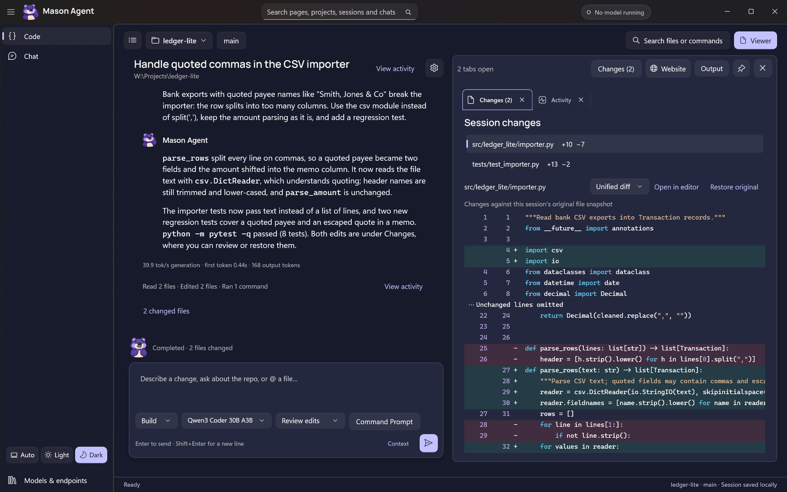
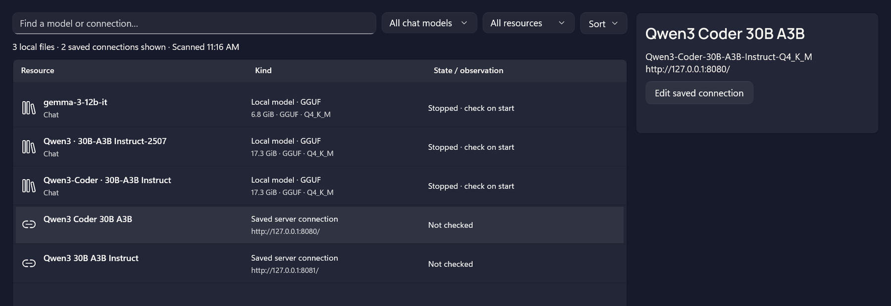

<div align="center">


# Mason Agent

**Make the next move clear.** A coding workspace for Windows that runs on your own local models.

[Website](https://masonagent.site) · [Download](https://github.com/afj176/mason-agent/releases/latest) · [Installer (x64)](https://github.com/afj176/mason-agent/releases/latest/download/MasonAgent-Setup-x64.exe) · [Portable ZIP](https://github.com/afj176/mason-agent/releases/latest/download/MasonAgent-win-x64.zip)

</div>

<picture>
  <source media="(prefers-color-scheme: dark)" srcset="docs/images/code-dark.png">
  
</picture>

## What it does

- **Projects that keep their history.** Add a folder; its coding sessions, files and changes stay together, with the Git branch in view.
- **Runs on your own models.** Start GGUF models with llama.cpp's `llama-server` or Transformers models with Python from the model library, or connect to an OpenAI-compatible server already running on localhost.
- **You set the permissions.** Sessions start read-only. Switch to *Review edits* (approve each edit and command), *Workspace edits*, or *Auto*, which runs commands in a Windows sandbox limited to the project folder with network access off unless you allow a destination. Commands run in Git Bash, PowerShell or Command Prompt.
- **Every change on record.** Edits appear as diffs against the original file and can be restored; the activity log lists each read, edit and command with its result.
- **Chat beside your code.** Conversations with any connected model, with code blocks, tables and attached documents. Long chats compact automatically and keep their originals.
- **A model library.** Scans your folders for GGUF and safetensors weights, estimates whether a model fits in your GPU memory, and downloads models from Hugging Face on request.

## Screenshots

| Review changes | Chat |
| --- | --- |
|  |  |
| **Models & endpoints** | **Code workspace, light** |
|  |  |

## Install

Download from the [latest release](https://github.com/afj176/mason-agent/releases/latest):

- **Installer** (`MasonAgent-Setup-x64.exe`, about 106 MB): installs for your Windows account into `%LOCALAPPDATA%\Programs\MasonAgent`; no administrator rights needed. Requires Windows 11.
- **Portable ZIP** (`MasonAgent-win-x64.zip`, about 125 MB): extract the whole folder anywhere and run `MasonAgent.exe`. Runs on Windows 11 and on Windows 10 version 2004 or later.

Both are x64 and self-contained (.NET and the Windows App SDK are included). Releases are not code-signed yet, so Windows SmartScreen may warn on first run: choose **More info → Run anyway**. SHA-256 files are attached to each release.

**You also need a model.** Model weights and runtimes are not bundled. Under *Models & endpoints*, point Mason Agent at:

- GGUF weights plus a llama.cpp `llama-server` executable, or
- Transformers (safetensors) weights plus a Python installation with the needed packages (an optional isolated runtime for GPTQ/AWQ models can be set up from the app; that setup downloads Python packages), or
- an OpenAI-compatible server already running on `localhost` / `127.0.0.1`.

Git for Windows is optional and adds Git Bash as a shell for commands. Using PowerShell in Auto mode needs a one-time setup that asks for administrator approval.

**Where settings live.** Settings, projects, sessions and chats are stored in `%LOCALAPPDATA%\MasonAgent`. To keep everything beside the app instead, put an empty file named `portable.flag` next to `MasonAgent.exe`; data then goes to a `data` folder in the same directory. The `MASON_DATA_HOME` environment variable overrides both. Your project folders are never moved; only the edits you allow are written to them.

## Build from source

Prerequisites:

- Windows 10/11 x64 and the [.NET 10 SDK](https://dotnet.microsoft.com/download). The Windows App SDK and Windows SDK build tools come from NuGet.
- For release builds: Visual Studio 2022 or later (or Build Tools) with the **C++ x64 build tools** for the native coding helpers, and Git for Windows.
- For the installer: [Inno Setup 6](https://jrsoftware.org/isinfo.php).

```powershell
# Run a Debug build (use MASON_DATA_HOME to keep test data away from your real profile)
dotnet build src\MasonAgent\MasonAgent.csproj -c Debug -p:Platform=x64

# Release payload and ZIP in artifacts\MasonAgent-<version>-win-x64
.\scripts\Publish.ps1 -Version 1.7.1

# ... plus the installer
.\scripts\Publish.ps1 -Version 1.7.1 -Installer -InnoCompiler "C:\Program Files (x86)\Inno Setup 6\ISCC.exe"
```

`Publish.ps1` refuses to overwrite an existing release folder and writes a SHA-256 `payload-manifest.json` into the payload.

### Checks

`tests/Mason.CodeChecks` covers the coding engine, projects and sessions, shells, the Windows sandbox and its network denial. The sandbox checks need a small native probe, built with the MSVC tools:

```powershell
.\scripts\Build-CodeSandboxProbe.ps1
$env:MASON_SANDBOX_PROBE = (Resolve-Path .cache\code-sandbox-probe\SandboxNativeProbe.exe)
dotnet run --project tests\Mason.CodeChecks -c Release
```

The default run uses scripted model responses and needs no model. The `--evaluate-*` modes in `tests/Mason.CodeChecks/Program.cs` run real coding tasks and need a local model server.

## Privacy

Everything stays on your computer: projects, sessions, chats and settings live in your local profile, and models are reached only on localhost. Mason Agent connects to the internet only when you ask it to: searching or downloading models from Hugging Face, setting up the optional quantized runtime, or allowing a specific destination for a sandboxed command. There is no telemetry.

## License

[MIT](LICENSE). Manrope is used under the SIL Open Font License 1.1; see [THIRD-PARTY-NOTICES.md](THIRD-PARTY-NOTICES.md).
