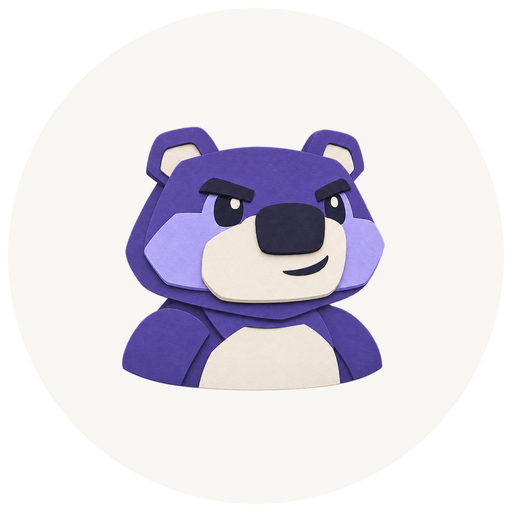
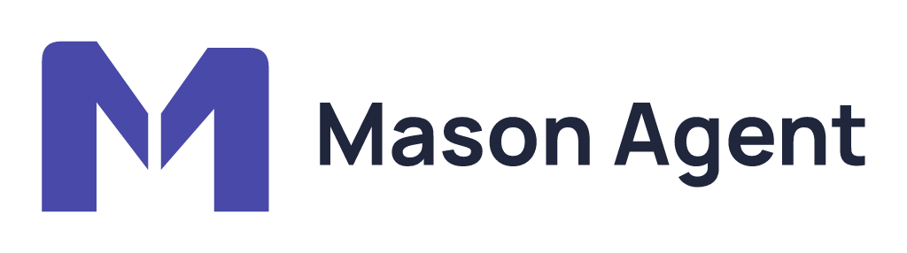
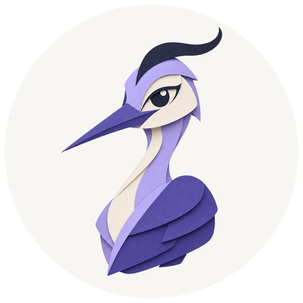
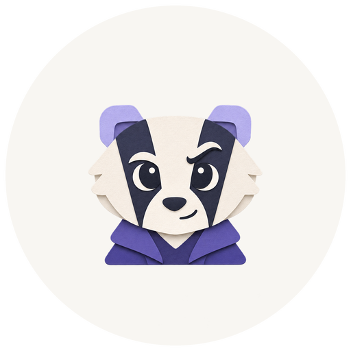
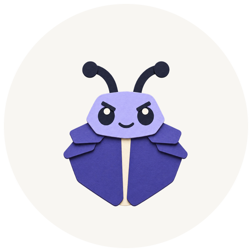
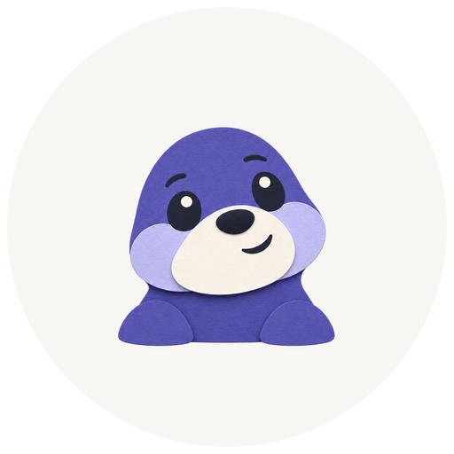

# Mason Agent brand guide

Mason Agent is a Windows coding workspace that runs on your own local models. You add a project, decide what the agent may do and review every change before you keep it. The identity is about careful building: the M is laid like two courses of brick with the joint left visible, and the tagline says what the product is for: **Make the next move clear.**

<picture>
  <source media="(prefers-color-scheme: dark)" srcset="logo-kit/png/brand-reversed-1024w.png">
  
</picture>

## The mascot

**Mortar** is a wombat cut from layers of violet and lilac card, with a broad cream face and a dark nose. The stepped cheeks and overlapping paper repeat the offset blocks of the M. Mortar is steady and quietly witty: someone who checks the work before saying it is done.

Four companions are made of the same paper. **Lintel** the heron is perceptive and brief, **Dovetail** the badger asks the exact question, **Rivet** the beetle is energetic and focused, and **Plumb** the seal is calm and dependable.

    

Where Mortar appears in the app:

- **Title bar and app icon.** Inside the app Mortar is the logo: a 32 px Mortar sits next to the wordmark, and the taskbar icon is Mortar too.
- **The agent's voice.** A small Mortar marks each of the agent's turns in a conversation, the way a person icon marks yours.
- **Welcome pages.** Mortar greets you on the first screen ("glad you're here") and waits on the empty project, session and chat pages.
- **Session status.** Next to a session, Mortar shows how it stands: "I'm on it" while working, "Let me check" when it waits for your review or approval, "Well played" when it finished with changes to review, "We're good" when it only answered, and "Oof" when it failed or was blocked.
- **Empty lists.** "Not convinced" appears when a search of your models finds nothing.

Mortar's eight moods are still images; nothing in the app animates in a loop. The companions are for profiles, documentation and community spaces, and do not appear in the app.

Please don't:

- Put Mortar inside the working surfaces, such as diffs, file views and command output.
- Use a cheerful mood for a failure, or any mascot art in place of the message. The text always says what happened.
- Recolour Mortar, add a badge or circle behind the cut-out, or crop the ears.
- Give the companions speaking parts in the app. Mortar is the only voice.

## Logo

| File (in `logo-kit/svg`, PNG copies in `logo-kit/png`) | Use it for |
| --- | --- |
| `brand-primary-outlined` | The default: the M and the wordmark side by side, on light backgrounds. |
| `brand-reversed` | The same lockup in white, for dark backgrounds. |
| `brand-symbol` | The M alone: favicons, profile pictures and other square spaces. |
| `brand-mono` | One-colour printing, in ink. |
| `brand-wordmark-outlined` | The lettering alone. The app places it next to Mortar. |

- **Minimum size.** In marketing and print, keep the logo at least 180 px wide and the symbol at least 24 px. The app's 48 px title bar uses a compact lockup instead: a 32 px Mortar and a wordmark 16 px tall, which works there because the window frames it.
- **Clear space.** Leave a margin as wide as one leg of the M on every side.
- **Do** use the SVG wherever you can, the PNG where you cannot, and the reversed logo on dark backgrounds.
- **Don't** stretch, rotate or recolour the logo, close the gap between the two halves of the M, add shadows or outlines, or set the name in a font yourself. The wordmark is drawn artwork (Manrope at weight 750, converted to outlines).

`logo-kit/preview/logo-usage.png` shows the four main versions on one sheet.

## Colour

Warm paper, blue-black ink and a single violet. The dark theme is a separate set of colours, not the light one inverted. `tokens.json` and `tokens.css` hold the same values for code.

**Light theme**

| Swatch | Hex | Used for |
| --- | --- | --- |
| Paper | `#F8F6F2` | Window and page background |
| White | `#FFFFFF` | Cards, panels and message surfaces; text on violet buttons |
| Ink | `#20263C` | Text and the wordmark |
| Muted | `#535B72` | Secondary text and captions |
| Violet | `#4849A8` | Buttons, links, selected items, progress, and the M itself |
| Hairline | `#D9DBE1` | Borders of cards and panels |

**Dark theme**

| Swatch | Hex | Used for |
| --- | --- | --- |
| Night | `#171A2B` | Window and page background; text on lilac buttons |
| Raised | `#24283E` | Cards, panels and message surfaces |
| Paper | `#F8F6F2` | Text |
| Silver | `#C3C9E0` | Secondary text and captions |
| Bright | `#C3C2FF` | Buttons, links, selected items and progress, with Night text |
| Seam | `#3B4059` | Borders of cards and panels |

Contrast, measured with the WCAG formula: Ink on Paper is 13.9:1, Muted on Paper 6.3:1, Violet on Paper 7.0:1 and white on Violet 7.5:1. In dark, Paper on Night is 16.0:1, Silver on Night 10.5:1 and Night on Bright 10.2:1. When Windows high contrast is on, the app drops the brand colours and uses the system ones.

Corners are 8 px on cards and panels and 20 px on the pill-shaped starter prompts.

## Typography

- **Manrope** (SIL Open Font License 1.1) for the wordmark and for page and panel titles, which are set semibold. The font file and its licence are in `logo-kit/fonts`.
- **Segoe UI Variable**, the Windows system font, for controls, conversation text and body copy. It is part of Windows and is not shipped with the app.

## Voice

Direct, capable and calm. Mason Agent says what it will do, what it did and where the limits are.

| Write | Rather than |
| --- | --- |
| "Bring a project into focus." | "Welcome to the future of coding!" |
| "New sessions cannot edit files until you change the permission mode." | "Your code is always safe with us." |
| "This project has no sessions yet. Its files are untouched; start a conversation when you're ready." | "Nothing here yet!" |
| "Review a session's file changes as diffs and restore originals." | "Undo AI mistakes with one click." |
| "Look through this project and suggest one small, low-risk improvement. Explain what you would change before editing anything." | "Let the agent refactor everything for you." |
| "Could not start a session", followed by the reason | "Oops, something went wrong." |

Name the file, the command and the result. Say "on this computer" when something stays local, and never promise more than the model and the permission mode allow.

## Files in this folder

| Path | What it holds |
| --- | --- |
| `tokens.json`, `tokens.css` | The palette, light and dark theme colours, fonts and corner radii, for code |
| `logo-kit/svg`, `logo-kit/png` | The logo versions listed above (PNG at 512 to 4096 px wide; the symbol from 64 to 2048 px) |
| `logo-kit/favicon` | Favicons, touch icons and a web manifest |
| `logo-kit/preview` | The logo usage sheet |
| `logo-kit/fonts` | Manrope and its licence |
| `characters` | Mortar and the four companions on round backdrops, 512 px |
| `graphics` | Share images as SVG and PNG: 1200 × 630 Open Graph, 1080 × 1080 square, 1500 × 500 header, a 1024 px profile picture and a 512 px maskable icon |

The app keeps its own copies of the art it shows, including Mortar's mascot art, in [`src/MasonAgent/Assets`](../src/MasonAgent/Assets). The website is in [`site`](../site).

## Licence

Everything in this repository, code and artwork alike, is under the [MIT licence](../LICENSE). Manrope is under the [SIL Open Font License 1.1](logo-kit/fonts/LICENSE-Manrope.txt).
