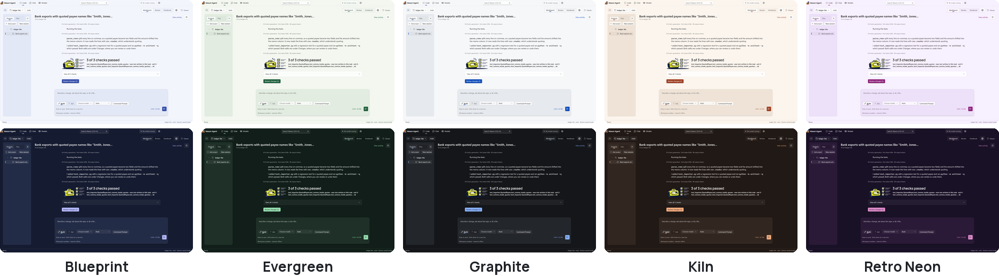

# What Mason Agent does

The full list of what the Windows, macOS and Linux apps and the `mason` command can do. The [README](../README.md) has the short version.

This section applies to the Windows, macOS and Linux apps. Where a step is reached differently, the text says which system it means, and each system's own section below has the rest.

- **Sessions by project.** Add a folder and Mason keeps its sessions, files and changes together. Ask for a change and watch each tool call as it finishes. Answers render Markdown and code.
- **Runs on your own models.** GGUF models run with llama.cpp, Transformers (safetensors) weights run through your own Python, and you can connect to an OpenAI-compatible server already running on this computer. Model weights and runtimes are not bundled.
- **Permissions.** Sessions start read-only. Switch to Review edits (approve each edit and command), Workspace edits, or Auto. In Auto, commands run in a sandbox limited to the project: the Windows sandbox on Windows, the macOS sandbox (`sandbox-exec`) on macOS, and [bubblewrap](https://github.com/containers/bubblewrap) on Linux. Sandboxed commands have no network access unless you allow a destination.
- **Approvals.** Each edit shows its diff before it is applied. **Always Allow…** saves a rule for that command prefix or folder in the project, and saved rules can be revoked in settings.
- **Changes.** One diff per changed file, with undo and redo of everything the latest request changed: its edits and whatever its commands created, changed or deleted. A file you changed since is left alone.
- **Long sessions.** Mason replaces the older messages of a long session with a summary and keeps the originals. Type `/compact` to do it yourself. On macOS and Linux it happens by itself when a llama.cpp model's context is nearly full.
- **Your agents and commands.** Markdown files with front matter in `.mason/agents` and `.mason/commands` (also `.claude` and `.opencode`). On macOS and Linux, type a command's name with a slash, or `/agent NAME` to use an agent.
- **MCP servers.** Add servers on this computer and choose which of their tools Mason may call. Servers live in `mcp-servers.json` in Mason's data folder, in the same form on all three systems, and never in a project. Every call shows its arguments and asks first unless a saved rule allows it; on macOS and Linux that holds in Auto too. On macOS and Linux, register a server with `/mcp add` in the `mason` command, by its `http://127.0.0.1` address or the full path of a program; the app uses the same servers, and typing `/mcp` there lists them.
- **Chat.** A separate pane for talking a problem through with a model, apart from your coding sessions. Chats are saved on your computer, and a long chat is compacted like a long session, keeping the originals. Attach pictures (PNG, JPEG, GIF, WebP) for a model that can see, and PDFs and Word documents, whose text is what is sent. A table in an answer is laid out as a grid, with a chart of each numeric column. On macOS and Linux, chat has no tools: it cannot read the project, edit files or run commands. There you can attach up to five text files to a message and stop an answer. Reading a Word document there needs `unzip`; on Linux a PDF needs `pdftotext` (poppler-utils).
- **Queue and steer.** While a request runs, the request box sends follow-ups. **Queue** handles the message after the request completes; **Steer** interrupts what Mason is doing and handles it next. Messages left waiting by a stop or a failure stay with the session, and `/queue` picks them up (on macOS and Linux there is also a **Run Queued** button).
- **Schedules and notifications.** Have a request run by itself hourly, daily, on weekdays or weekly. A scheduled run is unattended: nothing is approved for it. The app runs what is due while it is open, and a run missed while nothing was checking happens once, not once per missed time. When the window is in the background, a system notification tells you a session finished or is waiting for approval. On macOS and Linux, type `/schedule add NAME daily 09:00 -- REQUEST` (also `hourly :MM`, `weekdays`, `weekly DAY`, and `auto`) in the request box or in `mason`; the run is read-only unless you add `auto`, which lets it edit and run sandboxed commands, and `mason --run-due` runs what is due without the app.
- **More for the agent to work with.** Background jobs: the agent can start a server, a watcher or a long test run, read its output while it works, and every job stops when the request ends. Project workflows: named commands in `mason.workflows.json` that the agent runs by name (on macOS and Linux, for example, `{"version": 1, "workflows": {"test": {"executable": "python3", "arguments": ["-m", "unittest"]}}}`). Skills: instructions in `.mason/skills/NAME/SKILL.md` (on macOS and Linux also `.claude/skills`) that the agent is told about and reads when the work calls for one. It can also read a range of lines from a large file, make several edits to a file in one step, see Git status, get an outline of the project (each source file and what it defines), put a question about a few files to a separate read-only context, and ask you a question when only you can answer; the request then waits for your reply. Jobs and workflows ask first like any command, and run sandboxed in Auto.
- **Settings.** Settings hold the approvals saved for the project, with Revoke; the project's agents and slash commands; MCP servers, where you add a server, discover its tools and switch on the ones Mason may call; schedules, where you add, switch, remove or run one; and the theme.
- **Themes.** Five theme families, each with a light and a dark version: Blueprint (the default), Evergreen, Graphite, Kiln and Retro Neon. Choose one under Appearance in the gear menu on Windows, in Settings on macOS and Linux, or with `mason theme`. The app and `mason` share the choice, and the app follows your system's light or dark mode unless you pick one. A bear and a level-bot show what Mason is doing: reading, editing, running checks, waiting for your approval, or done.
- **Verified by Mason.** Mason runs the project's checks itself and puts a receipt under the answer. On macOS and Linux, give the project a workflow named `verify` in `mason.workflows.json` (its tests, say). When a request changes files, Mason runs it once before the first change and again after the model says it is done, and the receipt says: passed, passes now and failed before, fails now and passed before, or failing as before. A regression is handed back to the model to repair, twice at most. Mason runs it in Auto (sandboxed), or after you choose Always Allow for the verify workflow; otherwise the receipt says it was not run.
- **Comments, review and a plan.** Pin a comment to a line of a diff; comments go with your next request. A review has the model read what the session changed. A plan holds milestones: the files each covers and how it is checked, by a project workflow or by what you saw. A milestone needs checking again when one of its files changes. On macOS and Linux, the bubble beside a diff line in Changes pins the comment, and it is sent only while the file is unchanged; **Review** pins what the model finds as comments, and a finding is kept only when it quotes the line it names; milestones are in the **Plan** tab. In `mason` there: `/comment`, `/review` and `/milestone`.
- **Pages in a real browser.** The agent can load a project page in a real browser with a fresh profile, click, fill and read it, and see its controls and script errors. macOS and Linux use Chrome, Chromium, Edge or Brave, whichever is installed, headless and with no network beyond this computer; Windows uses Edge. Put scenarios in `mason.acceptance.json` (the same format on all three systems) and Mason runs each at a phone width and a desktop width: ask it to verify them, or on macOS and Linux type `/accept` in `mason`. A contract that names a Python WSGI application runs it in a throwaway copy of the project, and can also check its responses and the rows in its database. On macOS and Linux that copy runs inside the sandbox.
- **Fork, export and import.** Start a new session from before an earlier request, optionally putting the project back as it was then. Export a session as a file, with paths and secrets left out if you choose, and import one into a project. On macOS and Linux, right-click a request to fork (a file changed since is left alone and reported), and right-click a session to export it, with the project's path, likely secrets and file contents left out if you choose, or to import one. In `mason` there: `/fork`, `/export` and `/import`.
- **Search everything.** One search box reaches sessions, projects, the project's files, commands and chats: Ctrl+K on Windows and Linux, ⌘K on macOS.
- **Project notes.** Keep short facts about a project. The six newest are given to the model with each request, as background. A note about a file stops being sent once that file changes.
- **Generation settings and tools on request.** Temperature, top P, top K, min P, repeat penalty and seed are kept for each model connection and sent whenever it works as the coding agent. Specialised tools load a group at a time, so a local model is not sent every tool definition with every step.
- **Language servers.** Mason talks to the language servers on your computer the way an editor does. After each edit the file is handed to its language's server, and the errors the server reports go back to the model with the edit's result, so it fixes them before going on. A server starts the first time a request touches its language and stops when the request ends. On macOS and Linux it runs inside the sandbox in Auto and asks first otherwise; on Windows it runs with your account, so Mason asks before starting it, once a request, unless you saved a rule. Mason knows the servers for about 35 languages, among them C#, F#, Swift, C, C++, Go, Rust, Python, Java, Kotlin, PHP, Ruby, Lua, Zig, Dart, Elixir, Haskell, Scala, shell scripts, YAML, JSON, HTML and CSS. It ships none of them: one you installed is found on your PATH, and `/languages` (or Settings) shows the state for each language in the project and installs a missing one with that language's own tool (npm, go, dotnet, rustup or gem) when you choose to. To use any other server, name it for a file extension in `language-servers.json` in Mason's data folder. TypeScript, JavaScript and Python are also checked by the TypeScript compiler and Jedi that ship with the app.
- **Definitions and references.** The agent can find where a name is defined, used or tested (labelled text matches, for any language), and ask about one position: the TypeScript compiler answers for TypeScript and JavaScript, Jedi for Python, and the installed language server for every other language.
- **Checks Mason works out itself.** In Auto, a requirement with an exact outcome (`show a heading "Orders"`, `clicking "Add" must show "Added"`, `write notes.md containing "Shipped"`) becomes a check Mason runs when the model says it is done; for pages the model may propose more, kept only if Mason can run them and they quote your request. A failed check goes back to the model, and the request ends with what Mason found. A contract in a fenced `mason.acceptance.json` block at the end of a request is used the same way.
- **A store component.** Asked in Auto, in an empty folder, for a single offline `index.html` shop with unit prices, quantity discounts, a cart that clears on checkout and a saved receipt, Mason builds the page itself: the model reads the offers and writes the name, copy and colours; every name and price is checked against your request; totals are computed in whole cents; and the page is then run through scenarios made from the offers.
- **Experiments.** Copy the project as it stands, uncommitted and untracked files included, into a Git worktree beside it, work there, then see what the experiment changed a hunk at a time and put a chosen hunk back into the project. On macOS and Linux: `/experiment new NAME`, then `mason --workspace` to work there, `/experiment diff NAME` and `/experiment apply NAME PATH ID`. On Windows: **Fork session in an isolated worktree**.
- **Pull requests.** Build a draft from the hunks you choose, publish it to a new branch through the GitHub CLI only when you say so, and bring back CI feedback. On macOS and Linux: `/deliver review main` lists what your checkout has that `main` does not, a hunk at a time. `/deliver draft main all Title` builds one commit from the hunks you choose without touching your files, index or branches. `/deliver publish` pushes that commit to a new branch, never with force, and opens a draft pull request through `gh`. `/deliver feedback` brings back failed checks, requested changes and review comments. On Windows: **Git delivery & CI feedback**.
- **Background tasks.** Run a request in a separate process that keeps going after you close the app, with its approvals waiting for you. On macOS and Linux: `/task start REQUEST` starts a separate `mason` process that also outlives the terminal. Outside Auto it waits for `/task allow ID` before each edit and command; `/task show ID` follows it and `/task cancel ID` stops it. On Windows: **Background tasks**.
- **Model roles.** Use another local model for reviewing, and another for pictures of a window. On macOS and Linux: `/roles reviewer URL MODEL` sets the model for `/review` and the Review button, `/roles visual URL MODEL` the one for pictures of a window, and `/roles trace FOLDER` writes every model call to a folder outside your projects. On Windows: **Model roles & decision inspector**.
- **Your project's tests as evidence.** List a test in `.mason/tests.json` (the same format on all three systems) and, in Auto, a request that states its requirement is checked by it: Mason runs the workflow before the work and again at the end, and the requirement holds only if the named test passes with its own files unchanged. Results are read from TAP, JUnit, TRX, `go test -json` and `flutter test --machine`.
- **Files and Website.** A file viewer reads any file of the project (the model can point you at a line), and a Website panel shows a project page or a development server on this computer. Pick an element there and it goes into your next request with the page's console messages; Verify Click repeats the click in a fresh browser at a phone width and a desktop width. On macOS and Linux both are in the side panel, and the picked element is sent as its selector and HTML.
- **Network, when you allow it.** In Auto, a sandboxed command can be allowed to reach a destination you approve. On macOS and Linux: `/network ask` lets a sandboxed command ask for a host. It can then reach that host over HTTPS for the rest of the request, through a relay Mason runs; this computer, your local network and plain HTTP stay out of reach.
- **Project policy and hooks.** Switch tools off for a project, limit which workflows may run, and let workflows run by themselves as hooks. On macOS and Linux: `/policy disable TOOL` switches tools off, `/policy workflows NAME…` limits which workflows may run, and `/policy hooks on` lets workflows marked `"events": ["afterEdit"]` or `"beforeVerify": true` in `mason.workflows.json` run by themselves in Auto: after each edit, and as a gate before a request may finish. The policy is kept outside the project. On Windows: **Project policy & extensions**.
- **Bundles and documentation.** Install a bundle of skills, documentation and MCP servers for every project to use. On macOS and Linux: `/bundle install FOLDER` installs a folder of skills and docs (`bundle.json`, `skills/NAME/SKILL.md`, `docs/*.md`). With a bundle installed, or Markdown files in a project's `.mason/docs`, the agent can look things up with `read_documentation` and cite where an answer came from. A bundle can also name MCP servers in `mcp.json`; `/bundle servers NAME add` puts them in your list switched off, for you to look at and switch on. On Windows: **Project policy & extensions**.
- **A browser task for scripts.** The model carries out a task on a project page: each turn it sees what the page shows and its controls and picks one step, and Mason replays every step in a fresh real browser. On macOS and Linux the command is `mason browse --prompt "…"`.
- **Code search by meaning.** With an embeddings server, for example `llama-server --embedding` with an embeddings model, the agent can find code from a description. On macOS and Linux, choose the server in Settings (or `/embeddings URL MODEL`); each passage is embedded once, and a reranker is optional.
- **A window you attach.** Attach a window of another app. Mason reads the names of its controls, and asks you before pressing one or setting a value. For what the controls do not name (a canvas, a chart), a model that takes images can look at a picture of the window and propose one click or drag, which also asks first and happens only if the window still looks the same. On macOS and Linux, use the **Window** menu beside the request box (or `/window`), and Mason asks every time, in every permission mode.
- **Transformers weights.** A folder with `config.json`, a tokenizer and `.safetensors` weights is listed with your models and served through your own Python with PyTorch and Transformers installed. On macOS and Linux, nothing is downloaded and no code from the model folder is run; `/models check` tests a folder without loading it, and `/models python PATH` chooses the Python.
- **Models.** Lists the model files on your computer with what the agent can do with each, searches Hugging Face with a verdict on each result, installs a llama.cpp build for your hardware, downloads the build of a model you choose, and starts it. On macOS and Linux both downloads are verified against their published SHA-256, and a model Mason starts stops when Mason quits.

<picture><source media="(prefers-color-scheme: dark)" srcset="images/themes-dark.png"></picture>
