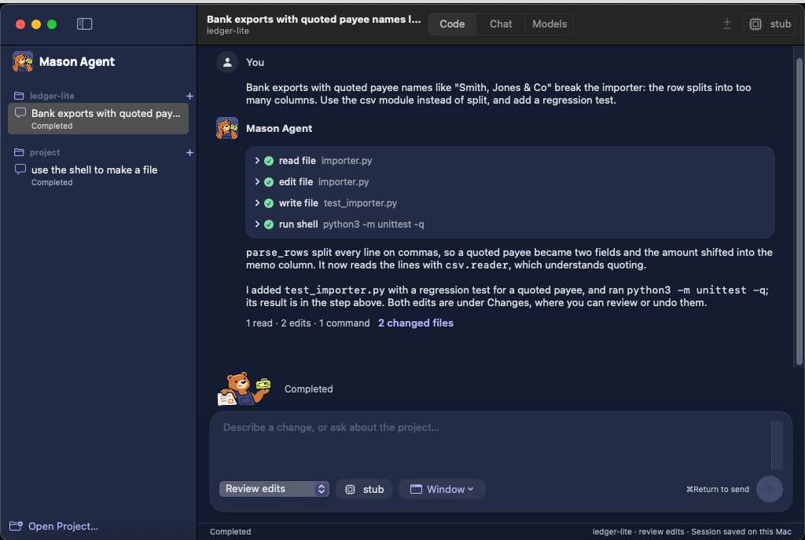
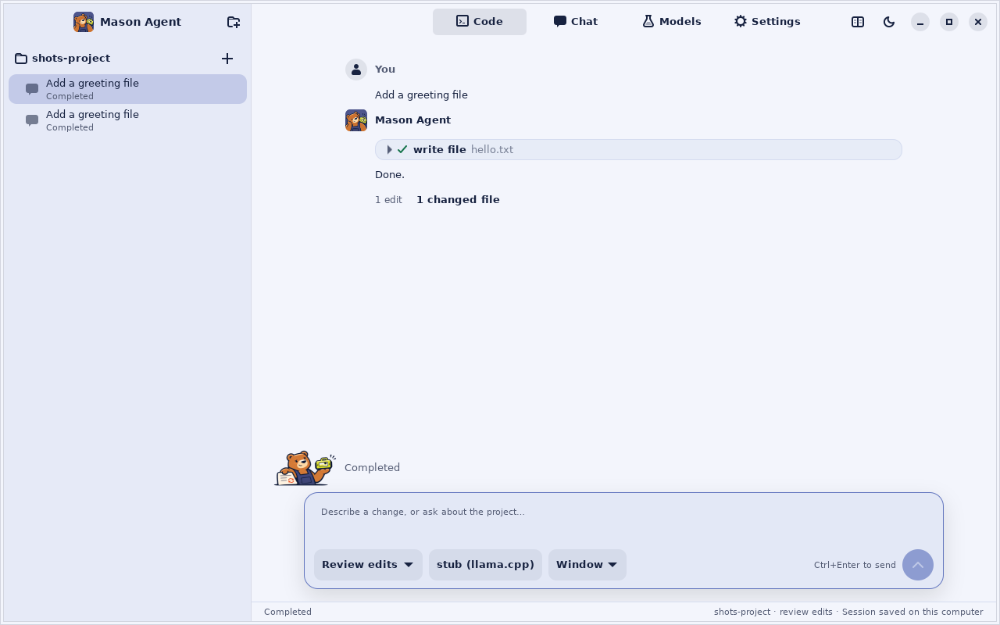

# The macOS and Linux apps

## macOS app

A SwiftUI app with the engine written in Swift, in [`macos/`](../macos). [Download](../README.md#macos). The screenshot is from the automated check on a Mac runner, where a stand-in model plays a short demonstration session.

- **Sandbox.** In Auto, commands run under the macOS sandbox: they can write only inside the project and your temporary folder, cannot read `~/.ssh`, `~/.aws`, `~/.gnupg` or your keychains, and have no network access. Where the sandbox is unavailable, Auto refuses to run commands instead of running them unprotected.
- **Settings.** Settings are in the Settings window (⌘,).
- **Schedules.** `mason --run-due` runs what is due from launchd.
- **A window you attach.** macOS asks once for the Accessibility permission, and for Screen Recording before the first picture (System Settings → Privacy & Security).
- **Models.** The list includes running local servers (Mason's own, llama.cpp, LM Studio, Ollama) and every GGUF file on the Mac. Mason installs the official llama.cpp build. Transformers weights use the Apple GPU on Apple silicon, otherwise the CPU.
- **Chat.** Chats are stored in `chats` in Mason's data folder on this Mac.

## Linux app

A GTK 4 and libadwaita app with its engine in C++, in [`linux/`](../linux). [Download](../README.md#linux). It has been built, packaged and run on Ubuntu 24.04, including a real request approved through the app against a local model.

<picture><source media="(prefers-color-scheme: dark)" srcset="images/linux-dark.png"></picture>

- **Sandbox.** In Auto, commands run under [bubblewrap](https://github.com/containers/bubblewrap): the system is read-only, only the project and a private `/tmp` are writable, credential folders such as `~/.ssh` and `~/.aws` are hidden, and there is no network. Where bubblewrap cannot create a sandbox, Auto refuses to run commands instead of running them unprotected.
- **Settings.** Settings are in the Settings page.
- **Schedules.** `mason --run-due` runs what is due from cron or a systemd timer.
- **A window you attach.** Mason uses AT-SPI, the accessibility interface GTK, Qt and most desktop apps speak, on X11 and Wayland; pictures of a window need an X11 session.
- **Models.** The list includes running local servers and every GGUF file on the computer. Mason installs the official llama.cpp build (Vulkan when a GPU and the Vulkan loader are present, otherwise CPU). Transformers weights use an NVIDIA GPU where its driver is installed, otherwise the CPU.
- **Chat.** Chats are stored in `chats` in Mason's data folder on this computer.
