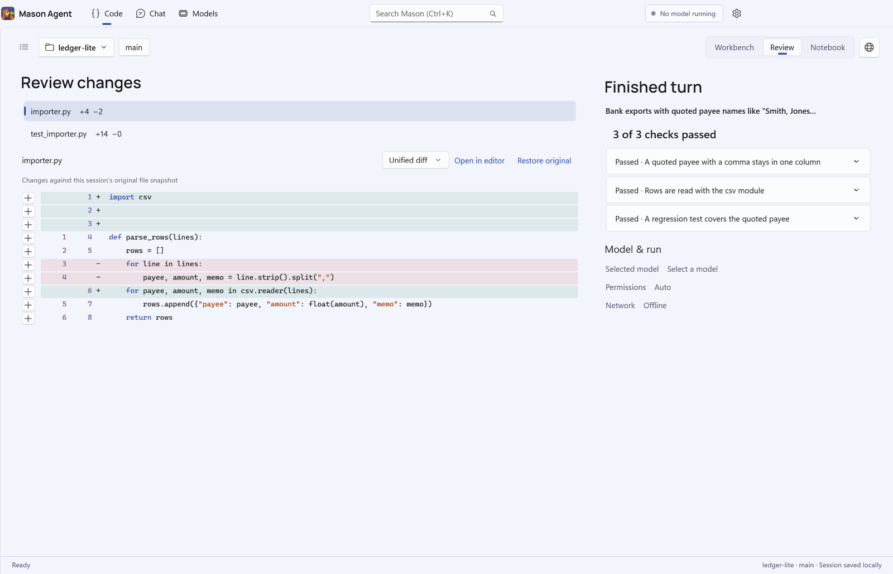
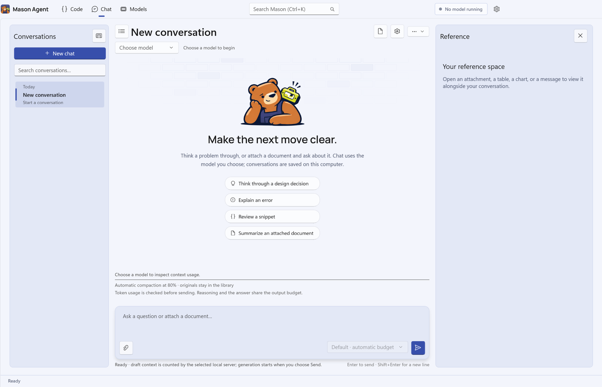
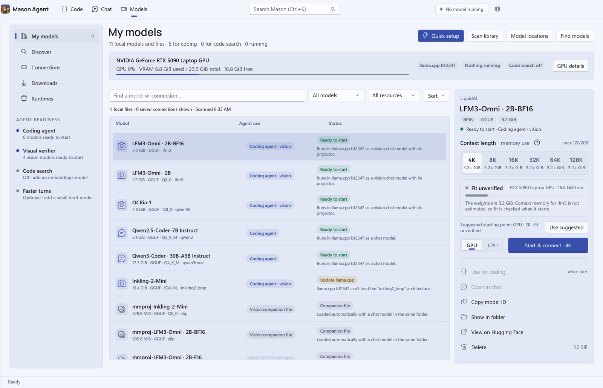
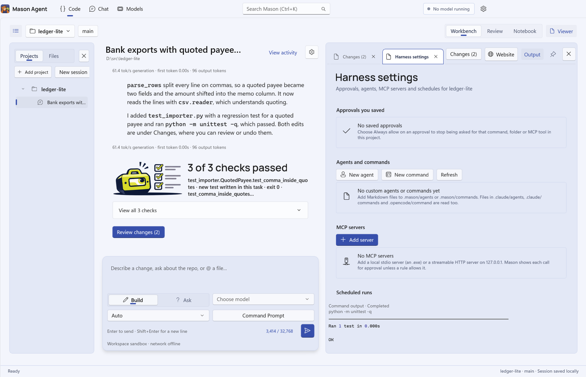

# The Windows app

A WinUI 3 app with the engine written in C#, in [`windows/`](../windows). [Download](../README.md#windows).

| Review changes | Chat |
| --- | --- |
| <picture><source media="(prefers-color-scheme: dark)" srcset="images/changes-dark.png"></picture> | <picture><source media="(prefers-color-scheme: dark)" srcset="images/chat-dark.png"></picture> |
| **Models** | **Harness settings** |
| <picture><source media="(prefers-color-scheme: dark)" srcset="images/models-dark.png"></picture> | <picture><source media="(prefers-color-scheme: dark)" srcset="images/harness-dark.png"></picture> |

The pictures show a demonstration session played by a stand-in model, in the Blueprint theme. The bear and level-bot appear at the moments that matter: the status row under a running session follows each step, and the approval card, check results, failures, the Models pages, notifications and the installer each have their own pose.

## In the Windows app

- **Projects.** Right-click a project in the sidebar or open its project menu and choose **Remove project from Mason**. Its files stay on disk. Adding the same folder again restores its sessions and project notes. Switch between Code, Chat and Models in the title bar. Ctrl+K searches sessions, projects, workspace files and commands. Each session remembers its workspace view. Workbench pairs the conversation with its artifacts, Review opens line comments beside the recorded checks, and Notebook gives the conversation a wider reading layout and follows your Mason appearance setting.
- **Models.** GGUF models run inside Mason Agent through llama.cpp, so there is no separate server process to start or keep alive. **Quick setup** under Models checks your GPU, installs the matching llama.cpp build, suggests a coding model that fits in its memory and starts it once you confirm the download. The library scans your folders for GGUF and safetensors weights, shows what each model can do for the coding agent, estimates whether it fits in your GPU memory, and downloads models from Hugging Face on request. Choosing a model sizes its context to the memory you have. Each connection can carry its own generation settings (temperature, top P/K, min P, repeat penalty, seed) for the coding agent.
- **Sandbox, shells and rules.** Auto runs commands in a Windows sandbox limited to the project folder with network access off unless you allow a destination. Commands run in Git Bash, PowerShell or Command Prompt. On an approval, **Always allow…** saves an editable rule for that command prefix, folder or MCP tool in this project. A deny rule always wins, and you can revoke rules in Harness settings (project menu → **Project policy & extensions**).
- **Changes.** Select a diff line to attach feedback and send several comments together. **Undo** in the session menu puts back everything a request changed, including files its commands created, edited or deleted, and **Redo** reapplies it; files you changed since are left alone and listed. Completed turns show the observations behind each feature check, with the full evidence and verified revision available to inspect.
- **Chat.** Conversations with any connected model, with code blocks, tables and attached documents. Favourite and recent models come first in the pickers. Long chats compact automatically and keep their originals.
- **Agents and commands.** Pick an agent in session settings; commands appear in Ctrl+K and take `$ARGUMENTS` or `$1`–`$9`. Mason Agent also reads `.claude/` and `.opencode/` folders.
- **Schedules.** A scheduled request runs as a background task while Mason Agent is open, and a run missed while it was closed happens once at the next start. The taskbar button shows progress and flashes when an approval is waiting, and Windows notifies you when Mason Agent is in the background.
- **Sessions.** Fork from any earlier request, optionally putting files back as they were then. Export a session as JSON, with paths and keys removed if you like, and import it into another project.

## Verification and acceptance

Build retains feature requirements, command failures and verification receipts across follow-ups and restarts. Start a new session or enter `/new` followed by a request to begin a separate task. Each verification records the revision of its inputs. In Auto, Mason checks fully specified literals when a relevant file already exists and after a file edit.

For multi-step browser checks, put a version 1 `mason.acceptance.json` in the project root and ask Mason to “verify the features in mason.acceptance.json”. Use “implement the features in mason.acceptance.json” to authorize edits. The [checkout fixture](../windows/tests/fixtures/checkout/mason.acceptance.json) checks distinct products, discount thresholds and order persistence in Edge at phone and desktop widths. A static project can omit `Application`. A Python WSGI project specifies a local `module:callable`. Mason starts it in an isolated temporary copy with a fresh database, observes same-origin requests and discards the copy at the end of each viewport check.

For an empty project, you can end the Build request with a fenced code block labeled `mason.acceptance.json` containing the same contract. Its scenarios define the automated acceptance criteria for that turn. Mason retains them in the session so edits to the project cannot change the assertions. Use `click_if_enabled` followed by an assertion to check controls that may legitimately be disabled, such as checkout on an empty cart. After `capture`, use `new_id` to require a distinct identifier and `same` to verify that identifier after a reload.

For a fresh, single-page offline store with unit prices, quantity discounts, a cart that clears on checkout and a saved receipt, Auto can use a built-in catalog component. The local model extracts the offers and writes the storefront copy and palette. The component computes line totals in cents and generates receipts. Edge exercises the resulting page, and a separate review derives checks from the brief and the rendered controls. Extra requirements stay on the general implementation and verification path.

The `navigate_code` tool finds C# definitions, bound references, related tests and compiler diagnostics using framework references. For Python, JavaScript/TypeScript, Go, Ruby and Dart it returns labeled text candidates. Project-specific compiler output is available in command receipts.

### Agent tools in 2.0

Auto builds of static browser features get a separate read-only review after the original checks pass. The reviewer receives the user's brief and the rendered page, with its own context. Mason pins its executable checks and runs them in fresh Edge profiles at both viewport widths. For explicit catalog prices it calculates independent basket totals. It also checks displayed prices and durable receipts when requested. Review results and failed steps appear in Activity.

In **Session settings → Attach or detach a window**, select an open Windows application to let Mason observe accessible controls. Build sessions ask you before invoking a control or setting a value. Attachments end when Mason closes. For project websites, the browser tool can operate a disposable Edge page, observe after each action and save a screenshot under the session profile. Desktop controls depend on the target application's Windows accessibility support.

Ask for TypeScript, JavaScript or Python symbol inspection at a file, line and column. TypeScript provides compiler diagnostics and bound definitions/references. Jedi provides Python definitions/references and syntax diagnostics. Both operate on a bounded source snapshot. Dependency-specific checks still use your project's build. Python inspection requires a local Python installation.

Store reusable instructions in `.mason/skills/NAME/SKILL.md`. Named workflows live in `mason.workflows.json`. Auto executes them inside the project sandbox. Setting `BeforeVerify` runs a workflow before final verification and a failed hook blocks completion. The agent can also start, poll and stop offline background jobs during a run. Jobs share the run's 30-minute deadline.

```json
{"Version":1,"Workflows":{"test":{"Executable":"python","Arguments":["-B","-m","unittest"],"Directory":".","BeforeVerify":true},"preview":{"Executable":"python","Arguments":["-m","http.server","8123","--bind","127.0.0.1"],"Directory":"."}}}
```

Add local MCP servers under **MCP servers** in Harness settings (project menu → **Project policy & extensions**): enter the endpoint, choose **Discover tools** to list what the server offers, and tick the tools the agent may call. Servers can be edited, switched off or removed there. They are saved in the Mason profile's `mcp-servers.json`, for example `[{"Name":"docs","Endpoint":"http://127.0.0.1:8088/mcp","Tools":["search_docs"]}]`. Mason negotiates MCP 2025-06-18 over HTTP, lists allowlisted tools, and shows the tool arguments for approval before a call unless an **Always allow** rule covers it. An unattended run declines approvals.

## Working with the coding harness

Click **Website** or a completed turn’s **Open preview** to open the selected HTML file or the project’s `index.html` in Mason’s embedded browser. Both actions can also reopen a standalone HTML page changed in the session or a local server tab in a server-only project. Use the address field for another project page or the loopback URL of a running development server. **Reload website** reads the latest files. Browser storage for the preview is kept under the Mason profile for that project.

During a coding run, **Steer** interrupts the current model action and applies your new instruction. **Queue** saves a follow-up for after completion. Use `/queue` to resume saved input after a stop. In the session menu, **Undo** previews and restores everything the latest request changed, including command output files, and **Redo** reapplies it. Requests sent with earlier versions have no snapshots, so for those **Rewind last edited turn** restores files changed through Mason's edit tools; a later external edit blocks the rewind before any files change. Commands and their side effects remain in the activity history.

Repository search can page through results and read numbered line ranges in UTF-8 files up to 8 MiB. The Repository menu and `mason git-status --workspace PATH` show staged, unstaged and untracked paths. A delegated investigation reads up to eight assigned files and returns findings with source citations. Mason checks the citations against the current files.

With a window attached and a local vision model loaded, Mason can inspect a screenshot and propose a click or drag. The approval shows the captured window. Mason checks the frame again before sending input and observes the result afterward. Text-only models can use supported accessibility controls.

For a local WSGI application, an acceptance scenario can combine Edge interactions, observed HTTP responses and an independent count of a SQLite table in the disposable application copy. The release trials exercise repeated checkout of one basket and separate checkout of two baskets. The two-model workflow qualification requires an interactive Windows desktop and at least one model serving images with a compatible projector.

### Plan and inspect a project

Open **Plan & repository map** in the project menu. Search for a qualified symbol to see definitions and callers. C# uses Roslyn. TypeScript, JavaScript and Python use their language services for supported declarations. Other matches carry a candidate label. Add milestones with files, dependencies and a verification workflow. A source change invalidates the affected receipt and blocks dependent milestones. A manual review has its own status. Project notes can be edited or forgotten and carry a source revision.

### Connect the preview and editor

Use the element picker in **Website** to attach an accessible control, its screenshot and recent console diagnostics. **Verify click** repeats the interaction in disposable Edge at mobile and desktop widths.

### Run tasks and review changes

**Background tasks** starts a detached local worker and reopens its progress and pending approvals after the desktop closes. The CLI supports `task-list`, `task-show`, `task-allow`, `task-deny` and `task-cancel`. An approval identifies both the task and the pending request. The workspace terminal supports line input, EOF, scrollback and cancellation. **Model roles & decision inspector** assigns the implementer’s review and vision partners and limits model calls. The optional trace recorder supports prediction-only comparisons of saved requests. GPU memory management applies to role models launched by the desktop.

**Fork session in an isolated worktree** starts an experiment from the current checkout, including uncommitted files. Compare experiments from the same turn, inspect their checks and apply a selected hunk. **Git delivery & CI feedback** prepares a local draft from the reviewed hunks. Publishing to the configured GitHub repository requires an explicit action and a configured GitHub CLI.

### Use a project's test suite

In `.mason/tests.json`, register the named test, the workflow that runs it, the files that define the test and the implementation inputs. For example, this entry uses a Node test named `discount` reported by a workflow named `test` in `mason.workflows.json`.

```json
[{
  "requirement": "Apply the loyalty discount",
  "workflow": "test",
  "format": "tap",
  "report": "",
  "test": "discount",
  "testFiles": ["price.test.cjs"],
  "inputs": ["price.cjs"]
}]
```

Auto records a baseline and reruns the pinned check before completion. Results distinguish new regressions, missing tests and failures present at baseline. For a direct CommonJS assertion with two JSON arguments, the reviewer can identify an order-independent operation before editing starts. Mason checks the existing source for simple symmetric expressions, pins a second assertion with the arguments exchanged when appropriate, and reports its result. A test owner can specify `argumentOrder` as `ordered` or `interchangeable` to declare the contract explicitly. CommonJS codec projects can also declare a `roundTrip` property on a named test with `module`, `encode`, `decode` and `alphabet`. The module must be a declared input. Mason exercises every string of length zero through three over that alphabet in the same workspace sandbox and returns the first counterexample. Supported reporters include TAP, TRX, JUnit XML, Go test JSON and Flutter test JSON. Use **Project policy & extensions** for tool restrictions, workflow allowlists, event hooks and versioned skill, documentation and MCP bundles. Installed bundles start disabled. Documentation excerpts include the source, version and location.
